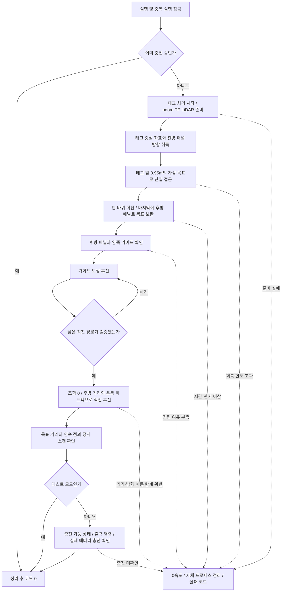

# STELLA N5 태그 중심선 도킹

실행 흐름은 **태그 중심선 접근 → 180° 회전 → 가이드 보정 후진 → 직진 완료**다.

**최신 실물 시험 96(2026-10-13)은 약 79.6초에 종료 코드 0으로 완료했고,
사용자도 실제로 정상 진입했음을 확인했다.** 전방 접근 28.7초, 회전 22.3초,
후진 약 17.5초였고 최종 후방 거리는 3.2cm였다. 패널로 회전 목표를 -0.77°
보완했으며 회전 직후 패널 오차는 약 0.1°였다. 패널까지 31.8cm 남았을 때
가이드 관측 다섯 개로 직진 경로를 검증한 뒤 조향을 0으로 하고 완료했다.
충전 명령은 0개, 마지막 속도는 0이고 사용자 bringup은 유지했다.
이번에는 기존 대칭 경계로 직진을 승인했으므로 `signed_rectangle` 분기의
별도 실물 효과까지 확인한 것은 아니다. 성공한 제어 설정을 유지하며 다음
단계의 반복 성공률이나 충전 성공을 이번 한 번으로 보장하지 않는다.
기록: `/home/user/docking_diagnostics/2026-10-13/trial96_report.md`.
아래 이전 시험의 미검증 표기는 해당 수정 직후의 상태다.

최근 실물 시험 95(2026-10-13)은 3cm 목표 보정으로 접근과 회전을 마쳤지만,
후진 직전 측면 여유 검사로 멈췄다. 실측은 왼쪽 2cm·오른쪽 8cm로 시험 94보다
개선됐으나 치우침이 남았다. 회전 스캔 정합은 약 175.8°, 후방 패널은 약 3.7°
오차를 지지했다. 기존 회전 마지막 구간에서 후방 패널로 종료 목표를 한 번
보완하도록 수정했다. 이 보완은 시험 96에서 실제 적용되어 전체 도킹을 완료했다.
기록: `/home/user/docking_diagnostics/2026-10-13/trial95_report.md`.

실물 시험 94(2026-10-13)은 전방 접근 22.7초와 odom 176° 회전을 완료했지만,
후진 직전 가이드 측면 여유가 약 0.6~1.0cm로 추정돼 정지 재확인 후 실패했다.
후진과 충전 명령은 0개다. 회전 전후 스캔 정합은 약 177.9°를 지지하므로,
이전 시험과의 차이를 새 고정 각도 변경만으로 해결됐다고 주장하지 않는다.
사용자 실측은 왼쪽 0cm·오른쪽 10cm로 실제 치우침이 확인됐다. 최근 패널 방향
융합 이후의 반복 실측을 근거로 기존 `apriltag_front_lateral_offset`을 -0.03m로
설정해 회전 전 목표를 왼쪽 3cm로 시험 보정했다. 카메라 TF와 회전 목표, 측면
안전 한계는 바꾸지 않았다. **이 보정의 실물 효과는 아직 검증하지 않았다.**
기록: `/home/user/docking_diagnostics/2026-10-13/trial94_report.md`.

실물 시험 93(2026-10-13)은 접근 시작 약 4초 만에 주행 피드백 신선도
검사로 종료했다. 별도 수집기의 odom·IMU·엔코더 최대 수신 공백은 약 0.08초라
센서 자체 중단으로 확정할 수 없다. 전방 접근의 일회성 신선도 실패도 기존
정지 관측 대기에서 회복하도록 바꿨다. 신선도 기준은 그대로이고, 새 주행
명령은 모든 피드백과 관측을 다시 확인해야 재개한다. **이 변경 후 실물 재시험은
아직 하지 않았다.** 기록: `/home/user/docking_diagnostics/2026-10-13/trial93_report.md`.

실물 시험 92(2026-10-13)은 전방 접근 끝에서 목표를 조금 지난 채
좌우 약 4cm·방향 약 15° 오차가 남아 진행 검사로 종료했다. 회전과 후진은
실행하지 않았다. 남은 거리에 맞춰 근거리 중심선 보정각을 조절하도록 수정했고,
카메라의 소프트 여백은 10%에서 5%로 줄였다. 태그 전체가 화면 안에 있어야 하는
검사는 유지한다. **이 전방 수정 후 실물 재시험은 아직 하지 않았다.**
검사·설치 결과: `/home/user/docking_diagnostics/2026-10-13/trial92_report.md`.

실물 시험 91(2026-10-13)은 전방 접근과 odom 176° 회전을 마치고 약 30cm
후진했다. 회전 직후 패널 오차는 약 1.3°로 줄었지만, 가이드를 잃은 뒤 직진
전환 증명이 없어 종료 코드 4로 멈췄다. 사용자 실측은 왼쪽 4cm·오른쪽 6cm다.
센서 공백 종료는 아니다. 기존 대칭 경계가 치우침과 기울기를 모두 불리한 방향으로
더하는 문제를 보완해, 실측 폭이 있는 스테이션에서는 차체 네 모서리의 실제
방향을 포함한 직진 경로도 검증한다. 측면 여유 2cm와 IMU·후방 거리·이동 제한은
유지한다. **이 직진 판정 보완 후 전체 실물 도킹은 아직 재시험하지 않았다.**
직진 판정 검사와 설치 결과: `/home/user/docking_diagnostics/2026-10-13/trial91_report.md`.

과거 시험 78(2026-10-12)은 당시 실행본으로 약 83.9초에 후방 거리 2.2cm,
종료 코드 0의 실물 성공을 확인했다. 아래 과거 시험의 미검증 표기는 각 수정
직후의 상태다. 기록: `/home/user/docking_diagnostics/2026-10-12/trial78_report.md`.

이후 사용자의 재시험은 실제 무선 패드에 밀착했지만 종료 코드 4로 끝났다.
사용자가 원하는 그 정지 위치에서 81개 스캔을 수집해 종료 목표를 **패널
거리 2.8cm ±3mm**로 보정했다. 기존 목표의 최대 2.45cm보다 깊게 밀 필요가
없다. 이 거리는 차체 기준점과 LiDAR에 보이는 패널 사이 값이며 무선 패드
표면 간격이 아니다. 새 목표는 기록의 77개 스캔, 최대 31회 연속 관측에서
성공 조건을 만족했다. 전체 570개 검사와 설치 빌드를 통과했다. 새 목표로
시작 위치부터 전체 실물 주행은 아직 재시험하지 않았다.
근거: `/home/user/docking_diagnostics/2026-10-12/user79_analysis.md`.
`drive_manager`가 SSH로 기존 명령을 실행해도 같은 설치 파일과 설정을 사용한다.

```bash
source /opt/ros/jazzy/setup.bash
source ~/colcon_ws/install/setup.bash
ros2 run docking dock_turn_backup
```

## 전방 접근

태그 중심 좌표와 전방 패널 방향으로 태그 앞 0.95m의 가상 목표 자세를 만든다. 하나의
제어 루프가 로봇 중앙과 방향을 그 목표에 맞춘다. Nav2 도킹 접근 후 여러 차례
정밀 보정을 반복하던 경로를 제거했다. **이 실행 경로는 OpenNav DockRobot
액션을 사용하지 않는다.** 스테이션까지의 일반 내비게이션은 기존 drive_manager
역할이며, `docking_server` 설정 블록은 별도 OpenNav 실행 도구용으로 남겨뒀다.

현재 스테이션 시험 보정은 `apriltag_front_lateral_offset: -0.03`이다.
회전 전 목표는 태그/패널로 만든 중심선에서 로봇 기준 왼쪽으로 3cm 이동한다.
회전 후에는 오른쪽으로 이동한 효과가 있어 반복된 왼쪽 쏠림을 줄이려는 설정이다.
이는 실제 카메라 TF 오차를 계측한 결과가 아니다. 최근 실측의 치우침이 약
1~5cm로 변동해 그 중간을 시험 보정하며, 새 실물 시험에서 양옆 여유를 확인해야 한다.
별도 정렬 동작이나 안전 기준 완화는 추가하지 않았다.

설치 설정의 `tag_front_use_lidar_panel_heading: true`는 전방 LiDAR로 패널
방향과 정면 거리/장애물을 확인한다. 좌우 중심점은 AprilTag 좌표만 사용한다.
태그 좌표 주위에서 깊이 ±20cm, 좌우 ±22cm 안의 정면 패널만 피팅하고,
12개 이상 점과 길이 25cm 이상의 지지가 있어야 방향을 사용한다. 전방 측면
가이드나 패널 피팅의 중점을 목표 중심으로 사용하지 않는다. 패널을 확인할 수
없으면 기존 관측 대기 과정에서 정지해 다시 확인한다. 이 설정을 명시적으로
false로 바꾸면 태그 법선을 사용하는 기존 방식이다.

시험 84에서 움직이지 않는 태그 원본 108개와 접근 후 정지 관측을 확인했다.
접근 후에도 태그 법선과 정면 패널 방향에 약 4~5° 차이가 남았고, 태그로 만든
목표가 실제 통로와 다를 수 있어 사용자 동의로 위의 방향 보완을 적용했다.
기록된 정지 스캔 95개에서 태그 주변 패널을 확인했으나, **수정 후 전체 실물
도킹 성공은 아직 검증하지 않았다.** 상세 근거는
`/home/user/docking_diagnostics/2026-10-13/trial84_panel_fusion_analysis.md`에 기록한다.

도킹용 브리지는 태그 모서리의 사영 행렬과 같은
촬영 시각의 rectified CameraInfo로 자세를 계산한다(`pose_source: homography`).
정지 상태에서도 PnP가 다른 방향 해로 바뀐 기록을 근거로 관측 계산을 교체했다.
카메라 축은 유지하고 태그의 로컬 축을 변환한다. 사영 잔차가 1픽셀을 넘는
관측은 거부한다. 이 검사는 실제 통로와의 정렬 정확도를 보장하지는 않는다.
방향은 최근 3~5개 관측의 중앙값으로 정리해
한 프레임의 자세 흔들림을 줄인다. **태그 위치는 촬영 시각, 패널 방향은
LiDAR 스캔 시각의 odom TF로 각각 변환하고 기억한다.** 최근 관측의 중앙값과 0.7초 시정수의
필터로 하나의 스테이션 추정치를 갱신한다. 먼 거리에서 처음 본 법선을 끝까지
고정하지 않으며, 가까워지며 얻는 관측이 목표를 보완한다. 서로 다른 시각의
태그 좌표와 현재 odom 방향을 직접 섞지 않는다. 관측이 잠시 끊겨도 추정치는
기억하지만 정지한 뒤 신선한 관측을 확인해야 재개한다. 목표 근처는 회전 명령도
줄이며, 마지막 방향 조정은 앞쪽 구동축을 기준으로 차체 중앙이 목표에 오도록 한다.
목표 앞 20cm 안에서 구동축이 중심선의 좌우 허용 범위에 들어오면 먼저 방향을
맞춘 뒤 남은 거리를 전진한다. 가까운 목표점의 방위각을 계속 쫓다가 태그를
화면 밖으로 돌리고 시야 보호와 반대 회전을 반복하는 것을 방지한다. 별도
재시도 단계나 목표 거리 축소는 추가하지 않는다. 시야 보호가 명령을 제한하면
`Front tag visibility limited command` 로그로 이유를 표시한다.

전방 접근 중 odom·IMU·엔코더 피드백이 한 번 오래됐다고 판단해도 즉시 전체
프로세스를 종료하지 않는다. 0 명령으로 멈춘 뒤 기존 관측 대기 **총 8초** 안에서
회복을 기다린다. 카메라/태그 대기와 같은 누적 예산이며 회복할 때 초기화하지 않는다.
재개에는 신선한 세 종류의 피드백, 각각 증가한 타임스탬프, 정지 확인과 새
태그/스캔 쌍 세 개가 필요하다. 신선도 기준은 odom/엔코더 0.5초, IMU 0.25초로
유지하며, 수신 시각과 메시지 시각을 모두 검사한다. 문제가 지속되면 제한 시간에
정지 상태로 종료한다. 로그에 각 센서의 신선도와 수신/헤더 나이를 표시한다.

마지막 35cm에서 아직 좌우 오차가 남으면 점의 방위각 대신 중심선을 향하는
보정각을 사용한다. 남은 거리의 절반(최소 5cm)을 기준으로 보정각을 정하고,
패널 정면에서 최대 25°로 제한한다. 남은 거리가 20cm 아래로 줄면 제한도
연속적으로 15°까지 줄인다. 그 방향으로 회전하는
동안 전진을 줄여 남은 정렬 거리를 먼저 소모하지 않는다. 정렬된 직선 전진의
최고 속도는 유지한다. 앞뒤 허용 오차의 절반 안에서만 진행할 수 있고,
최신 태그 거리·정지 관측·완료 허용값은 계속 확인한다. 수정 근거는
`/home/user/docking_diagnostics/2026-10-13/trial86_report.md` 및
`/home/user/docking_diagnostics/2026-10-13/trial92_report.md`에 기록했다.
현재 소프트 영상 여백은 좌우 5%다. 모든 예측 시점에서 태그 모서리가 화면
경계 안쪽 2픽셀 이상에 있어야 하며, 이미 잘린 태그나 오래된 보정 정보로는
이동하지 않는다. 여백을 줄여 작은 방향 보정을 허용하되 이 검사는 유지한다.

| 설정 | 현재 값 |
| --- | --- |
| 태그 앞 가상 목표 거리 | 0.95m |
| 접근 최고 속도 | 0.08m/s |
| 접근 최고 회전 속도 | 0.15rad/s |
| 정지 위치 허용 오차 | 앞뒤 2cm, 좌우 1.2cm, 방향 1° |
| 접근 이동/시간 한도 | 2m / 60초 |
| 전체 도킹 시간 한도 | 180초 |

기존 파라미터 이름 `tag_refinement_*_tolerance`는 새 접근 루프의 정지 허용
오차에 사용한다. 목표 근처만 감속하고, 세 번의 서로 다른 정지 관측이 맞으면
곧바로 180° 회전한다. 초기 회전 보정, 중간 법선 재잠금, 별도 최종 보정,
회전 전 전진, 별도 후방 정렬/전진 재진입은 자동 실행 경로에서 제거했다.

**회전 목표 거리는 0.95m보다 줄이지 않는다.** 완료 직전에도 최신 태그 관측의
전방 거리가 목표 거리에서 앞뒤 허용 오차 2cm를 뺀 값 이상이어야 한다.
이 거리는 태그 중심 기준이며, 주변 모든 장애물과의 회전 여유를 보장하지는 않는다.

태그는 실제 가이드 중앙에 설치돼 있다. `apriltag_front_lateral_offset: 0.0`으로
태그 중심을 지나는 패널 법선을 목표 중심선으로 삼는다. 시험 68/70/72 뒤 적용했던 왼쪽 2cm 고정
보정은 시험 82에서 회전 후 오른쪽 치우침을 키울 수 있어 제거했다. 이전의
편향이 모든 시작 위치에서 같은 값이라는 근거가 없으므로 새 고정값으로
대체하지 않는다. 카메라 TF는 변경하지 않는다. 시작 로그에 적용 오프셋을,
접근 완료 로그에는 목표 오차 `y`와 보정 전 태그 중심선 오차
`tag_centerline_y`를 함께 표시한다. 오프셋이 0이면 두 값은 같다.
구동축이 허용 범위에 들어왔더라도 본체 중앙이 범위 밖이면 마무리 회전을
계속한다. 구동축 기준 정지와 본체 기준 완료 판정이 서로 어긋나 정지 상태로
수렴을 기다리는 문제를 방지한다.
설치 설정은 좌우 1.2cm·방향 1°를 사용한다. 시험 85에서 이전의 2.5cm 기준은
1.9cm 잔여 오차를 허용했고, 회전 후 실측 여유가 2cm·8cm라 후진 가드에
걸렸다. 더 좁은 기준을 접근 중에도 사용해, 가상 목표에 가까워지기 전에
좌우를 더 맞춘다. 고정 좌우 오프셋이나 추가 보정 단계를 만들지 않는다.
회전 후 오차까지 보장하는 값은 아니며, 후진 시 양옆 여유 2cm 검사는 유지한다.
태그 법선만 쓰는 과거 시험 75처럼 목표 바로 옆에서 시작하면 좁은 기준에
수렴하지 못할 수 있으므로, 전체 시험은 회전 공간이 있는 시작 위치에서 한다.
상세 기록: `/home/user/docking_diagnostics/2026-10-13/trial85_report.md`.

## 후진

기존 후진 제어의 가이드 보정과 검증된 직진 전환을 유지한다. 신뢰할 수 있는
가이드 관측 다섯 개로 남은 통로의 폭·중심·방향을 확인하고 후방 패널까지
남은 거리가 32cm 이내이면 조향을 0으로 하고 후진한다. 초기 후진에는 가이드
보정을 유지해 캐스터 정렬 중의 작은 방향 변화에 대응한다. 따라서 근거리에서
가이드가 시야 밖으로 사라져도 검증된 직진 구간에서는 계속 진행할 수
있다. 가이드를 한 번도 확인하지 못한 상태를 중앙 정렬 성공으로 간주하지는 않는다.

실측 폭 54cm 설정에서는 기존 대칭 경계가 거부한 경우에도, 다섯 관측의 중심과
각도의 부호를 유지해 남은 직선 이동 동안 네 모서리의 양쪽 여유를 계산한다.
통로 폭 불확실성 1cm, 위치 여유 3mm와 각도 여유 0.1°를 반영한 뒤에도
양쪽 2cm 이상이어야 하며, 전환 순간에는 추가 2mm를 확보한다. 직진 중에는
처음 정한 선에서 벗어난 이동량을 odom과 IMU로 누적하고 같은 모서리 검사를
반복한다. 실제로 안전한 직선 경로를 확인한 경우에만 가이드 유실을 허용한다.
새 정렬 단계나 재시도는 추가하지 않았다. `corridor_check=signed_rectangle`
로그는 이 계산으로 전환했음을 나타낸다.

명목상 180° 회전은 odom 목표를 사용하며 현재 `spin_yaw`는 176°다.
반복된 정지 스캔 정합에서 더 많이 돌아간 회전량이 추정돼 기본 180°에서 4° 줄였지만,
시험 94/95에서는 반대로 실제 회전량이 부족한 추정이 나왔다.
`spin_use_lidar_heading: true`는 명목 목표까지 12° 이내인 마지막 구간에서
후방 패널로 같은 회전의 종료 목표를 한 번 보완한다. 지지점 12개 이상,
인라이어 비율 70% 이상, 길이 25cm 이상인 서로 다른 스캔 세 개의 목표가
1° 안에서 일치해야 한다. 스캔 시각의 odom TF로 변환하며 보완량은 명목
목표의 ±8° 안으로 제한한다. 충분한 관측이 없으면 기존 odom 목표를 유지하고,
후진 시의 패널/가이드 안전 검사는 그대로 적용한다. 회전 속도와 시간 제한,
다섯 odom 관측의 정지 확인은 유지한다. `Spin target confirmed by three rear
panel scans`와 `target_source=rear_panel` 로그로 적용 여부를 확인한다.
시험 96에서는 패널 목표 보완이 적용됐고 회전 직후 패널 오차 약 0.1° 및
전체 도킹 성공을 확인했다. 이는 외부 계측으로 회전량 180°를 확정한 결과는 아니다.
패널 오차 **12° 이내**는 기존 제자리 보정으로 처리한다. **방향 정지 기준은 3°**이며, 제자리 보정 후에는 1° 이내 및 정지 상태의
안정된 관측을 확인한 뒤 재개한다.
가이드 중심 보정의 최대 목표는 2.5°다. 초기 캐스터 교란이 더해져 3° 제자리
보정으로 너무 일찍 전환되는 것을 줄이되, 그 정지 기준을 높이지 않는다.
제자리 보정은 최대 0.06rad/s, 8초, 누적 18° 회전과 진행 여부 검사로 제한한다.
패널을 잃었을 때의 독립적인 방향 변화 제한 8°는 별개로 유지한다.
패널 거부 로그는 각도 한계 초과와 피팅 품질 부족을 구분해 표시한다.

실측 폭이 설정된 가이드 제어에서는 시작 때 저장한 정지 패널 방향과 신선한
IMU 회전량을 같은 계수로 필터링해 **제자리 보정 진입 판단**에 사용한다.
IMU와 패널의 일치 오차가 기존 2° 한계 안이고, 기존 패널·가이드 검사를
통과해야 한다. 이 범위를 벗어나면 실시간 LiDAR 판단을 유지한다. 일반 조향,
측면 여유 및 직진 경로 검사는 실시간 LiDAR를 계속 사용하고, 제자리 보정
자체와 정지 확인도 기존 패널 기준이다. 새 액션이나 정지 한계 완화는 없다.
`heading_pause_error`와 `heading_pause_source`가 전환 판단에 사용한 오차와
출처를 표시한다. `lidar_heading_error`는 실시간 피팅값이다.


스테이션은 알루미늄 프로파일 구조다. 진입 후 가이드가 LiDAR의 관측 각도
밖으로 넘어가거나 반사가 약해지는 것은 예상되는 현상이다. 품질 검사를 통과한
초기 관측부터 다섯 개의 통로 검증에 사용한다. 실측 폭 54cm를 설정한 이
스테이션에서는 좌우 조향 기준인 1.5cm를 직진 전환의 필수 조건으로 다시
요구하지 않는다. 대신 폭 불확실성 1cm, 좌우 추정 여유 3mm, 차체 길이와
남은 이동 거리를 포함해 양옆 2cm의 여유가 유지되는 경로인지 계산한다.
직진 전환 후에는 가이드 재관측을 요구하거나 다시 조향하지 않는다.
실측 폭이 설정된 스테이션에서는 직진 중 이미 발생한 좌우 이동량을
누적해서 여유에서 빼고, 남은 거리와 차체 전체 길이로 방향 한계를 다시
계산한다. 따라서 처음의 전체 후진 거리를 끝까지 중복 적용하지 않는다.
누적 좌우 이동은 odom의 통로 수직 성분과 IMU 방향에 따른 이동 추정 중
큰 값을 사용하며, 여유 소진·센서 공백·거리 초과 시에는 정지한다.

현재 스테이션 안쪽 폭은 54cm, 로봇 폭은 44cm다. 직진 전환 뒤에도 후방 거리,
IMU 방향, 이동량, 장애물 검사는 유지한다. 후진 최고 속도는 0.035m/s이며,
정해진 후방 거리까지 도달하고 정지해야 성공이다.
가이드 측면 여유 부족 관측은 즉시 종료하지 않고, 0속도로 멈춰 기존 가이드
재관측 예산 **3초** 안에서 확인한다. 부족 관측에 사용한 중심 필터와 직진
전환 이력은 지우고, 서로 다른 새 스캔의 안정된 가이드 관측이 확보되고
양옆 2cm 여유 검사를 통과하면 재개한다. 반복되는 잘못된 관측이나 가이드
유실이 대기 예산을 갱신하지 않는다. 실제 부족 상태가 계속되면 정지 후 실패를
보고하며, 후진을 강제하거나 실패를 성공으로 바꾸지 않는다. 로그는 관측 폭과
실측 폭에서 불확실성을 뺀 안전 계산용 폭(현재 53cm)을 구분해 표시한다.
2026-10-13 사용자 재시험 81의 실패는 회전 후 0.36초 만의 이 측면 검사였고,
도킹 완료 거리나 센서 공백에 의한 실패가 아니었다. 현재 위치의 80개 스캔에도
약 3cm 중심 편차와 3° 패널 오차가 남아 있어, 이 대기 보완만으로 현재 위치의
전체 도킹 성공을 보장하지 않는다. 실제 좌우 여유 확인 및 실물 재시험이 필요하다.
이 수정은 전체 581개 검사와 설치 빌드를 통과했다.
이후 사용자가 실제 여유를 오른쪽 약 4cm, 왼쪽 약 7cm로 확인했다. 가이드가
패널 좌표계에 있는 반면 초기 측면 검사에서는 로봇 후방 중심을 y=0으로
비교하던 기준점 불일치를 보완했다. 후방 중심도 같은 패널 좌표계로 변환해
비교한다. 기울기 3°에서는 이 좌표 차이가 약 1.2cm이며, 기울기 방향에 따라
계산된 측면 여유가 커질 수도 작아질 수도 있다. 실측 폭이 설정된 초기 진입
검사에 적용하며, 기존 조향용 중심 값과 차체 전체 길이를 사용하는 직진 전환
검사는 유지한다. 새 정지 스캔 80개에서는 중앙 편차 중앙값이 기존 약 3.8cm에서
실제 후방 기준 약 2.3cm로 바뀌었다. 전체 595개 검사와 설치 빌드를 통과했다.
이 수정 후의 전체 실물 주행은 미검증이다.
현재 설치 프로필의 후방 목표는 사용자 확인 밀착 위치인 2.8cm ±6mm다.
서로 다른 정지 스캔 3개와 연속 패널 점들의 지지를 계속 요구한다.
사용자 재시험 80에서 안전 영역은 약 2.7cm로 정지를 요구했지만 정면 패널은
약 3.2cm여서 이전 ±3mm 완료 범위에 들어가지 못했다. 후진 정지 목표 2.8cm를
그대로 두고, 확인된 두 밀착 위치의 거리 차이를 포함하도록 완료 허용 폭을
6mm로 보완했다. 현재 위치의 80개 정지 스캔은 모두 새 완료 조건을 만족했다.
이 변경은 방향 한계나 가이드 유실 처리를 바꾸지 않는다. 완료 범위는
2.2~3.4cm이며, 그보다 가까운 연속 패널 과진입과 가까운 측면 장애물은
성공으로 처리하지 않는다. 상세: `/home/user/docking_diagnostics/2026-10-12/user80_analysis.md`.

DDS UDP 자원 부족(`retcode -5`) 반복 메시지는 preload 보호 라이브러리에서
프로세스당 30초에 한 번 요약 경고로 표시한다. 송신 실패 반환·재전송·센서
검사는 바꾸지 않으며 다른 DDS 오류는 그대로 출력한다.
`STELLA_DDS_LOG_THROTTLE=0`이면 원본 전체 출력을 복원한다. 새 도킹 실행부터
적용되고, 이미 실행 중인 bringup은 재시작 후 적용된다.

## 센서와 정지

태그/scan 유효기간 0.30초, IMU 0.25초, odom/휠 0.50초를 유지한다. 전방
태그와 scan의 시각 차이는 0.15초 이내여야 한다. 전방 관측이 끊기면 0속도로
대기한다. 최근 태그 다섯 개 중 scan과 촬영 시각이 가장 가깝고 해당 시각의
odom TF가 준비된 유효 관측을 선택한다. 가장 최신 영상이 아직 odom TF보다
앞서 있거나 scan 시작 시각과 멀다는 이유만으로 기존의 유효 관측을 버리지
않는다. 과거에 사용한 촬영 시각보다 뒤로 돌아가거나 관측 시각을 고쳐 쓰지 않는다.
관측을 실제로 잃었을 때에는 기존과 같이 0속도로
대기하고 새 관측 세 쌍과 신선한 운동 센서/정지를 확인한 뒤 재개한다. 전방
대기 예산은 전체 접근 동안 누적 8초이며, 60초 접근 시간 안에 포함된다.
움직이는 중 운동 센서가 유실되면 즉시 중단한다. 실패를 성공 코드로 바꾸거나
오래된 관측으로 계속 주행하지 않는다.

기존 bringup은 이 실행 파일이 시작하거나 종료하지 않는다. 정리 대상은 이번에
시작한 태그 처리/브리지다. 로컬 DDS 전달 보완과 UDP guard는 유지한다.
관련 설정은 [bringup README](../stella_bringup/README.md)에 있다.

## 테스트 모드와 검증 상태

현재 `development_test_mode: true`로 **도킹까지만 수행하고 충전하지 않는다**.
종료 코드 0은 설정한 후방 거리까지 진입했음을 뜻하며 충전 확인을 뜻하지 않는다.

2026-10-12 시험 66은 먼 거리의 태그 방향을 고정한 버전에서 전방 정렬에
실패했다. 사용자가 확인한 실제 중심 오차는 약 15cm였다. 위의 촬영 시각에
맞춘 좌표 변환·스테이션 추정 갱신·구동축 기준 마지막 회전으로 수정했다.
실측 로그 재현과 지연을 포함한 검사를 수행했으며 결과는 아래 기록에 있다.
시험 67에서는 전방 정렬과 회전 후 가이드 중심 오차가 약 2cm로 줄었지만,
후진 6cm 지점의 2cm 여유 경계에서 정지했다. 이후 기존 -3cm 좌우 보정을
0으로 되돌렸다. 시험 68은 전방 정렬과 회전 후 약 33cm 후진했고 가이드
유실 대기에서 코드 4로 종료했다. 사용자는 실제 진입 자세가 좋고 그대로
후진하면 된다고 확인했다. 이후 위의 초기 관측 활용과 직진 전환 조건을
수정했다. **이 마지막 수정 뒤 실물 도킹 완료는 아직 확인하지 않았다.**
수정 후 전체 471개 검사와 설치 빌드를 통과했고, 설치된 실행 환경에서도
새 직진 전환 코드와 테스트 모드 설정을 확인했다.

시험 69는 후진 전에 전방 정렬에서 종료했다. 목표 근처에서 위치 추종과
태그 시야 보호가 반대 방향으로 회전시켜 정렬이 수렴하지 않았다. 위의
중심선 진입 후 방향 우선 제어로 수정했다. 따라서 시험 69는 후진 직진 전환의
실물 완료 검증이 아니다.
이 전방 제어 수정 후 전체 480개 검사와 설치 빌드를 통과했다. 수정본의
실물 재시험은 시작 위치를 복원한 뒤 수행해야 한다.

시험 70에서는 전방 계산 오차가 앞뒤 1.8cm, 좌우 0.5cm, 방향 0.13°로
완료됐고 180° 회전도 마쳤지만, 실제 진입 중심은 맞지 않았다. 사용자가
오른쪽 여유 약 10cm를 확인했다. 후방 가이드의 최소 여유 1.8cm가 설정한
2cm에 미달해 **후진 명령을 내기 전에 정지했다**. 계산상 전방 완료와 실제
중앙 정렬은 구분해야 한다. 태그 방향과 회전 후 패널 방향에 약 4.5° 차이가
있어 원본 영상·태그 모서리·카메라 보정을 함께 확인할 예정이다. 이 불일치의
원인은 아직 확정되지 않았으며, 여유 기준이나 좌우 오프셋은 완화하지 않았다.

시험 71 전 정지 관측 144개에서 PnP 방향이 약 -1.05~+6.89°로 바뀌는 현상을
재현했다. 사영 행렬 기반 계산은 약 +2.85~+5.79°로 연속적이었다. 이 계산으로
실물 접근을 시험했지만 약 22cm 전진한 뒤 관측 대기 예산 8초를 소진해 종료했다.
카메라와 태그의 수신 공백은 각각 최대 0.097초, 0.230초였고, 주된 대기 이유는
최신 태그와 scan의 시각 차이 및 태그 촬영 시각의 odom TF 미도착이었다.
이후 위의 유효 관측 선택을 보완했고 전체 524개 검사와 설치 빌드를 통과했다.
이 보완 뒤 실물 도킹 완료는 아직 검증하지 않았다.

시험 72에서는 누적 관측 대기가 0.26초로 줄었고 전방 단계 18.6초와 180°
회전을 완료했다. 하지만 후진 전 가이드 최소 여유가 7mm로 계산돼 정지했다.
사용자는 회전 후 오른쪽 여유 약 9cm로 실제 편향을 확인했다. 후진/충전 명령은
없었다. 이후 위의 설치별 좌우 보정과 본체 기준 마무리 회전을 반영했다.
이 마지막 보완 뒤 전체 538개 검사와 설치 빌드를 통과했으며 설치된 설정도
확인했다. 실물 검증은 시작 위치를 복원한 뒤 필요하다.

시험 73에서 이 수정본으로 전방 정렬·180° 회전·후진을 모두 완료하고
77.7초에 종료 코드 0으로 끝났다. 후진 중 가이드 중심 약 -4mm에서 검증된
직진으로 전환했고, 가이드 관측이 사라진 뒤에도 후방 거리 2.2cm까지 진입했다.
마지막 속도 명령은 0이고 충전 명령은 없었다. 수정본의 실물 성공 1회이며
반복 성공률이나 충전 성공을 검증한 것은 아니다. 근거는
`/home/user/docking_diagnostics/2026-10-12/trial73_report.md`에 기록했다.

이후 사용자 재시험에서는 회전 후 패널 오차 약 -9°가 기존 8° 수용 범위를
넘어 제자리 보정에 들어가지 못하고 종료했다. 패널 수용 범위를 12°로 바꾸고,
3° 이상에서 후진 정지 후 평행 보정하는 기존 제어를 유지했다. 재현 검사와
전체 553개 검사, 설치 빌드를 통과했다. 이 수정 뒤 실물 재시험은 아직 필요하다.
근거는 `/home/user/docking_diagnostics/2026-10-12/user74_analysis.md`에 기록했다.

시험 75는 회전 전에 전방 마지막 정렬에서 종료했다. 2.2cm 구동축 잔여
오차가 2cm 기준을 넘어 점 추종으로 들어가 반대 방향으로 회전했다.
위의 기존 좌우 허용 2.5cm를 복원했고, 실제 자세의 양쪽 방향 재현과 전체
557개 검사·설치 빌드를 통과했다. 이 설정으로 실물 도킹은 아직 재검증하지
못했다. 근거는 `/home/user/docking_diagnostics/2026-10-12/trial75_analysis.md`에 있다.

시험 76에서는 전방 정렬과 180° 회전을 완료했고 초기 가이드 중심 오차는
약 3mm였다. 하지만 남은 거리 48.5cm에서 직진으로 전환한 뒤 초기 방향
추정 0.757°가 경로 허용값 0.741°를 넘어 후진 약 1.7cm에서 멈췄다.
초기 후진 동안 가이드 보정을 유지하도록 직진 전환 거리를 50 → 32cm로
줄였다. 속도나 대기 단계는 바꾸지 않았으며 전체 559개 검사와 설치 빌드를
통과했다. 이 설정의 실물 재검증은 아직 필요하다. 근거는
`/home/user/docking_diagnostics/2026-10-12/trial76_analysis.md`에 기록했다.

시험 77에서는 후진 24.4cm 뒤 남은 거리 약 7.6cm에서 방향 1.210°가 초기
고정 한계 1.208°를 넘어 정지했다. 위의 누적 좌우 이동과 남은 거리 계산을
적용한 뒤 시험 78에서는 전방 정렬 26.1초, 180° 회전, 후방 방향 보정 및
후진을 완료했다. 남은 거리 31.5cm, 가이드 중심 -6mm에서 직진 전환했고
가이드 유실 후에도 끝까지 진행했다. 충전 없이 코드 0으로 종료했다.

변경 전 코드·설정·시험은
`/home/user/docking_diagnostics/2026-10-12/before_centerline_refactor/`에 보관했다.
삭제한 이전 보정 단계 전용 검사는 새 단일 제어기 검사로 교체했으며, 기존
회전·후진·정지·관측 시각·DDS 검사는 유지한다. 상세 기록은
`/home/user/docking_diagnostics/2026-10-12/centerline_refactor_report.md`를 참고한다.

## update_1013 — 누적 변경사항 및 현재 도킹 작동 방식

작성 기준: **2026-10-13, 실물 시험 96의 성공 설정**. 이 절은 그동안의 변경을 현재 소스와 설치 설정, 실제 시험 기록을 기준으로 다시 정리한 것이다. 위쪽의 시험별 기록에는 당시의 설정과 “아직 검증하지 않았다”는 표현이 남아 있다. **현재 동작과 수치는 이 절 및 [config/docking.yaml](config/docking.yaml)을 기준으로 읽는다.**

### 1. 현재 확인된 결과와 적용 범위

현재 기본 실행은 다음 순서다.

**AprilTag 중심 좌표 + 전방 패널 방향으로 접근 → 후방 패널로 마무리하는 반 바퀴 회전 → 가이드 보정 후진 → 검증된 직진 후진 → 후방 거리로 완료**

시험 96에서는 이 전체 과정을 실제 로봇으로 실행했고, 사용자가 끝까지 정상 진입한 것을 확인했다.

| 항목 | 시험 96에서 확인한 값 |
| --- | --- |
| 전체 실행 시간 | 약 79.57초, 초기 대기와 종료 정리 포함 |
| 전방 접근 | 28.7초, 약 1.173m 이동 |
| 전방 완료 추정 오차 | 앞뒤 +1.9cm, 보정 목표 대비 좌우 +0.2cm, 방향 -0.07° |
| 회전 | 약 22.3초 |
| 회전 종료 목표 보완 | 후방 패널로 명목 목표에서 -0.77° 보완 |
| 회전 직후 후방 패널 오차 | 약 +0.10° |
| 후진 | 약 17.5초, 약 45cm |
| 직진 전환 시점 | 후방 거리 31.8cm, 가이드 중심 -0.4cm, 패널 방향 -0.184° |
| 완료 거리 | 차체 후방 기준으로 약 3.2cm |
| 도킹 노드 종료 코드 | **0** |
| 실제 진입 확인 | 사용자: “정상적으로 끝까지 진입했습니다” |
| 충전 명령 | **0개** |
| 마지막 주행 상태 | `/cmd_vel`와 odom의 선속도·각속도 모두 0 |
| 기존 bringup | 종료하거나 재시작하지 않음 |

이번 결과는 **현재 설정으로 실물 도킹 전체 성공을 1회 확인한 결과**다. 여러 시작 위치에서의 반복 성공률과 실제 충전 성공까지 검증했다는 뜻은 아니다. 전방 완료 오차는 태그와 패널 관측으로 계산한 값이며, 외부 장비로 차체 위치를 측정한 값과 구분한다.

성공 기록은 [trial96_report.md](/home/user/docking_diagnostics/2026-10-13/trial96_report.md), 원본 센서는 [automatic_96_motion_sensors.json.gz](/home/user/docking_diagnostics/2026-10-13/automatic_96_motion_sensors.json.gz), 당시 설정은 [trial96_successful_config.yaml](/home/user/docking_diagnostics/2026-10-13/trial96_successful_config.yaml)에 보존했다.

### 2. 기존 구조에서 무엇을 단순화했는가

기존에는 OpenNav 접근과 여러 전방 정밀 보정·후방 보정·진입 복구 경로를 조합하면서 실패를 막는 추가 경로가 늘어났다. 현재 기본 실행은 [DockTurnBackup.run()](docking/dock_turn_backup.py)의 한 흐름으로 정리했다.

1. 센서, TF와 태그 관측 준비를 확인한다.
2. [TagCenterlineApproach](docking/centerline_approach.py)의 단일 루프로 가상 목표 위치와 방향을 함께 맞춘다.
3. [MotionController.spin_180()](docking/motion.py)에서 반 바퀴 회전한다. 마지막 구간의 목표 보완도 이 회전 루프 안에서 처리한다.
4. `backup_with_lidar()`의 한 후진 루프에서 패널 방향, 가이드 중심, 직진 전환, 최종 거리를 처리한다.
5. 테스트 모드이면 충전 확인 없이 성공을 반환한다. 일반 모드이면 그 뒤 충전을 확인한다.
6. 0속도 전송과 자체 자식 프로세스 정리를 마친 후 프로세스를 종료한다.

현재 `dock_turn_backup`은 **OpenNav `DockRobot` 액션을 호출하지 않는다.** 스테이션 근처까지의 일반 내비게이션과 SSH 실행 요청은 `drive_manager` 쪽 역할이고, 모바일 로봇 안에서의 마지막 접근·회전·후진은 이 패키지가 수행한다.

다음 항목은 소스에 남아 있는 것과 실제 실행되는 것을 구분해야 한다.

| 항목 | 현재 기본 실행에서의 상태 |
| --- | --- |
| `docking_server` YAML 블록 | 별도 OpenNav 사용을 위한 설정으로 남아 있음 |
| `start_docking_server` | `false`; 기본 실행은 서버를 시작하지 않음 |
| `lifecycle.py` | 서버 관리용 코드가 남아 있으나 기본 도킹 흐름에서 활성화 절차를 호출하지 않음 |
| `entry_recovery.py` | 이전 진입 복구 코드가 남아 있으나 현재 기본 `run()`에서 호출하지 않음 |
| `LidarPlaneAligner.align()` | 별도 정렬 코드가 남아 있으나 기본 흐름은 독립 정렬 단계 대신 패널/가이드 추정 함수를 사용 |
| `advance_before_spin()` | 함수와 파라미터는 남아 있으나 현재 기본 `run()`은 별도 전진 단계를 호출하지 않음 |
| `use_lidar_alignment` | LiDAR 준비 조건과 관련된 선언이 남아 있음; 이를 켠다고 현재 흐름에 별도 정렬 단계가 자동 추가되지는 않음 |

따라서 `start_docking_server: true` 하나만 바꾼다고 현재 흐름이 과거 OpenNav 도킹 액션 방식으로 돌아가는 것은 아니다.

### 3. 전체 데이터와 제어 흐름



회복 가능한 관측 공백은 해당 단계에서 먼저 0속도로 대기한다. 도식의 실패 경로는 그 회복 한도를 넘겼거나 실제 안전 조건을 만족하지 못한 경우다. 가이드가 사라졌다는 사실만으로 성공 또는 직진 허가를 만들지 않는다.

### 4. 파일별 역할

| 파일 | 담당하는 동작 |
| --- | --- |
| [runtime.py](docking/runtime.py) | ROS 초기화 전에 DDS 환경과 보호 라이브러리를 준비하고 실제 메인으로 진입 |
| [dock_turn_backup.py](docking/dock_turn_backup.py) | 전체 순서, 태그 준비/관측 이력, 전역 시간 제한, 종료 코드, 정리 |
| [centerline_approach.py](docking/centerline_approach.py) | 스테이션 추정, 가상 목표, 전방 위치·방향 제어, 관측 대기 |
| [tag_centering.py](docking/tag_centering.py) | 태그 법선 해석, 전방 패널 피팅, 전방 거리 확인, 스테이션 좌우 보정 |
| [tag_pose.py](docking/tag_pose.py) | homography와 rectified 카메라 보정으로 태그 자세 계산 |
| [apriltag_bridge.py](docking/apriltag_bridge.py) | 검출/보정 동기화, 촬영 시각 TF, 태그 자세 발행 |
| [image_rectifier.py](docking/image_rectifier.py) | 영상 보정, mono8 변환, 처리율 제한, 입력 상태 진단/재연결 |
| [tag_visibility.py](docking/tag_visibility.py) | 태그 모서리를 영상에 남겨두도록 이동 예측과 회전 명령 제한 |
| [motion.py](docking/motion.py) | 회전, 후진, 속도 명령, 운동 센서 유효성, 최종 완료 확인 |
| [lidar_alignment.py](docking/lidar_alignment.py) | RANSAC/PCA 패널 방향, 좌우 가이드 선과 중심 추정 |
| [docking_lidar.py](docking/docking_lidar.py) | LaserScan 수신/시각/프레임 검증, TF 해석, 유효 스캔 스냅샷 |
| [lidar_geometry.py](docking/lidar_geometry.py) | 스캔의 차체 좌표 투영, 후방 거리, 연속 점과 고유 스캔 검사 |
| [control.py](docking/control.py) | 구동축 목표 오차, 직진 경로 여유, 제한된 제자리 회전, 콜백 처리 주기 |
| [charging.py](docking/charging.py) | 충전 출력과 실제 충전 상태/전류 확인 |
| [stack_manager.py](docking/stack_manager.py) | 이번 실행에서 시작한 태그/브리지 등의 소유권과 종료 관리 |
| [safety.py](docking/safety.py) | 중복 실행 잠금, 부모 종료 신호, 종료 코드 정의 |
| [config/docking.yaml](config/docking.yaml) | 현재 로봇·스테이션용 실행 설정 |
| [config/tags_36h11.yaml](config/tags_36h11.yaml) | AprilTag 검출기 설정 |

### 5. 좌표계와 실제 차체 조건

주행 제어는 `odom`을 고정 좌표계, `base_link`를 차체 좌표계로 사용한다. 차체 기준 `+x`는 전방, `+y`는 왼쪽이다. 여기서 “왼쪽·오른쪽 여유”는 **그 시점의 로봇 정면 기준**이다. 180° 회전 전후에는 스테이션에서 본 좌우와 로봇에서 본 좌우가 반대가 되므로 부호를 혼동하면 안 된다.

| 항목 | 현재 기준 |
| --- | --- |
| 실제 차체 폭 | 약 0.44m |
| 차체 반폭 | `backup_rear_half_width = 0.22m` |
| 후방 차체 기준점 | `backup_rear_reference_x = -0.2295m` |
| 전방 차체 기준점 | `tag_front_body_reference_x = +0.2295m` |
| 직진 경로 계산에 사용하는 차체 길이 | 0.459m |
| 전방 구동축 위치 모델 | `apriltag_front_axle_x = +0.10m` |
| 현재 스테이션 안쪽 가이드 폭 | 사용자 실측 0.54m |
| 가이드 폭 불확실성 | 전체 폭에서 0.01m 차감 |
| 최소 측면 여유 | 0.02m |
| 전방 LiDAR | `/scan`, `base_scan`, 차체 x 약 +0.202m |
| 후방 LiDAR | `/scan_2`, `base_scan2`, 차체 x 약 -0.166m |
| 태그 | `tag36h11:0`, 설정 크기 0.154m |

두 스캐너의 실제 TF yaw는 시험 기록에서 약 π였다. 스캔의 원시 0°를 차체 전방으로 가정하지 않고 **TF로 `base_link`에 투영한 후**, 차체 전방 0°/후방 π를 기준으로 영역을 선택한다.

카메라 위치와 방향도 TF를 사용한다. 예를 들어 `camera_link`와 `camera_color_optical_frame`은 서로 다른 프레임이므로, 카메라 본체 위치와 컬러 렌즈의 광학 프레임 위치를 같은 값으로 가정하지 않는다. 이번 좌우 보정에서 카메라 TF를 새로 계측하거나 바꾸지는 않았다.

로봇은 앞쪽 구동륜과 뒤쪽 캐스터의 조합이다. 뒤쪽 캐스터는 후진을 어느 정도 이어가야 정렬된다. 따라서 작은 오차 때문에 정지·제자리 회전·후진을 반복하면 캐스터가 다시 돌아가 오차가 커질 수 있다. 초기 후진에는 가이드 피드백을 유지하고, 검증된 경로에서는 멈추지 않고 직진으로 이어가도록 했다.

### 6. 카메라 영상부터 태그 좌표까지

#### 6.1 영상 처리 경로

기본 태그 launch는 기존 bringup의 RealSense 영상을 받아 다음 경로를 만든다.

```text
/camera/camera/color/image_raw 또는 image_raw/compressed
    + /camera/camera/color/camera_info
    → image_rectifier
    → /apriltag/image_rect + /apriltag/camera_info_rect
    → apriltag_ros
    → /apriltag/detections
    → apriltag_bridge
    → 실행별 /stella_docking_<식별자>/detected_dock_pose
```

`image_rectifier`는 입력 영상과 CameraInfo의 **같은 취득 시각·프레임**을 요구한다. 느슨한 시각 보정으로 다른 영상과 다른 CameraInfo를 억지로 묶지 않는다.

영상 보정에서는 다음을 변경했다.

- 설치 환경에서 종료 문제가 있었던 `image_proc` 경로 대신 OpenCV 기반 보정 노드를 사용한다.
- 실제 영상과 `CameraInfo.P`가 일치하도록 rectification 후의 보정 정보를 함께 발행한다.
- 해상도, 왜곡 계수, ROI/binning 등이 바뀔 때만 rectification map을 다시 계산한다.
- 검출에 필요한 `mono8` 영상으로 변환하고 최대 10Hz로 처리한다. 원본 카메라 전체 발행률을 이 값으로 강제 변경하는 것은 아니다.
- 입력은 `auto/raw/compressed`를 지원한다. 시험 96에서는 compressed 입력을 사용했다.
- rectified 영상 출력은 기본 BEST_EFFORT, CameraInfo 출력은 RELIABLE로 사용한다.
- 영상과 CameraInfo가 모두 1초 이상 끊기면 해당 노드의 입력 구독자와 동기화 큐만 다시 만든다. 재연결 간격은 최소 2초이고 기본 최대 2회다.
- 태그가 없는 영상은 카메라 입력 정지와 구분한다. 태그가 안 잡힌다는 이유만으로 카메라를 재시작하지 않는다.
- 원본 영상, CameraInfo, 정확히 동기화된 쌍, 출력 영상의 카운트를 기록한다. 영상 자체 미수신과 검출 실패를 구분하기 위한 진단이다.

카메라 드라이버나 사용자 bringup 전체를 도킹 노드가 재시작하는 구조는 아니다.

#### 6.2 태그 자세 계산을 homography로 변경

정지한 상태에서도 PnP의 평면 자세 해가 바뀌면서 태그 방향이 여러 도 변한 기록이 있었다. 현재 도킹용 브리지는 `pose_source: homography`로 설정해, 검출된 사영 행렬과 같은 시각의 rectified CameraInfo로 자세를 계산한다.

계산의 핵심은 다음과 같다.

1. 검출기의 homography `H`와 rectified 내부 파라미터 `K`를 읽는다.
2. 태그 실제 크기 `s`를 사용해 `K⁻¹ H diag(2/s, -2/s, 1)`로 정규화한다.
3. 두 평면 축의 길이로 위치 축척을 정하고 SVD로 회전행렬을 직교화한다.
4. AprilTag의 단위 좌표 축을 도킹에서 사용하는 태그 로컬 축으로 맞춘다. 카메라 축을 임의로 돌리는 처리가 아니다.
5. 태그 모서리를 다시 영상에 투영해 검출된 모서리와의 오차를 검사한다.
6. 같은 촬영 시각의 카메라→차체 TF로 `base_link`의 태그 자세를 만든다.

태그가 카메라 뒤에 있거나 지나치게 가깝고, 비정상 행렬/보정 정보가 있거나, 모서리 재투영 RMSE가 1픽셀을 넘으면 관측을 거부한다. 이 검사는 사영 계산의 일관성을 확인하며, 실제 통로 중앙과의 절대 정확도를 보장하는 검사는 아니다.

검출기 설정의 `pose_estimation_method: pnp`는 남아 있다. 그러나 현재 도킹용 브리지가 사용하는 측정은 검출기의 PnP TF 결과가 아니라 **검출 homography에서 재계산한 자세**다. 태그 크기 0.154m도 검출기와 브리지, 영상 시야 검사에서 일치시켰다.

브리지는 같은 시각의 검출과 CameraInfo, 지정한 태그 ID를 요구한다. 오래되거나 반복·역행하는 취득 시각은 새 관측으로 발행하지 않는다. `pose_stamp_delay_sec`는 이전 명령 호환을 위해 선언만 남았고, 값을 주더라도 촬영 시각을 바꾸지 않도록 무시한다.

### 7. 태그 중심선 기억과 가상 목표 생성

#### 7.1 전방에서 센서별로 사용하는 값

| 입력 | 전방 접근에 사용하는 정보 | 사용하지 않는 방식 |
| --- | --- | --- |
| AprilTag | 스테이션 중심의 위치 좌표 | 단순 영상 중앙 맞추기만으로 차체 중앙을 판정하지 않음 |
| 전방 LiDAR | 태그 주변 패널의 정면 방향, 정면 거리/장애물 여유 | 양쪽 가이드 또는 피팅 패널의 중점을 전방 목표 중앙으로 사용하지 않음 |
| odom/TF | 측정 시각의 차체 자세, 목표까지의 현재 위치·방향 오차 | 과거 영상 좌표를 현재 차체 자세와 바로 섞지 않음 |
| IMU/엔코더 | 신선도와 차체 정지 확인 등 | 태그 위치를 대신하는 새로운 스테이션 좌표로 사용하지 않음 |

태그 법선과 실제 패널 방향에 약 4~5° 차이가 남는 관측을 근거로, 사용자 동의 후 `tag_front_use_lidar_panel_heading: true`를 적용했다. 이때도 **좌우 목표의 위치는 태그 중심 좌표**에서 만든다.

전방 패널은 태그 주위 깊이 ±20cm, 좌우 ±22cm 영역을 선택해 RANSAC/PCA로 피팅한다. 최소 12개 지지점, 길이 25cm 이상의 선, 전방에서 30° 이내의 방향이 필요하다. 옆 가이드나 먼 배경이 목표 중심이 되지 않도록 검색 영역을 태그에 묶었다. 같은 스캔의 피팅은 캐시한다.

#### 7.2 서로 다른 취득 시각을 각각 변환

카메라와 LiDAR는 같은 순간에 측정하지 않는다. 허용된 150ms 차이라도 회전 중에는 방향 오차가 생길 수 있으므로 다음처럼 처리한다.

- 태그 위치: **카메라 촬영 시각**의 `odom ← base_link` TF로 변환한다.
- 패널 방향: **LiDAR 스캔 시각**의 TF로 변환한다.
- 최근 태그 이력 최대 5개 중 스캔과 취득 시각이 가깝고 해당 시각의 TF가 있는 유효 관측을 선택한다.
- 태그/스캔 시각 차이는 최대 150ms, 태그 유효 나이는 최대 300ms다.
- 이미 사용한 촬영 시각보다 과거로 돌아가지 않으며, 서로 다른 태그와 스캔 쌍만 새 관측으로 센다.
- 최근 0.5초 안의 관측 3~5개에서 중앙값을 취하고, 시간상수 0.7초의 필터로 스테이션 추정치를 갱신한다.

처음 먼 거리에서 본 방향을 끝까지 고정하지 않는다. 가까워지며 얻은 관측으로 보완한다. 반대로 한 프레임의 흔들림으로 전체 목표가 즉시 바뀌지 않도록 중앙값과 시간 필터를 사용한다.

“한 번 태그를 보면 기억해야 한다”는 요구는 `odom`상의 스테이션 추정치와 목표를 유지하는 것으로 반영했다. 다만 기억한 값만으로 관측이 끊긴 상태에서 계속 주행하도록 만들지는 않았다. 관측이 끊기면 먼저 정지하고, 신선한 관측을 확보한 뒤 같은 목표 추정을 이어간다.

#### 7.3 가상 목표의 식과 좌우 보정 부호

스테이션 중심을 `p`, 패널을 향하는 정면 단위 벡터를 `u = (cos θ, sin θ)`, 그 왼쪽 단위 벡터를 `v = (-sin θ, cos θ)`라고 하면 목표는 다음과 같다.

```text
가상 목표 위치 g = p - d·u - o·v
가상 목표 방향   = θ

d = apriltag_front_standoff       = 0.95m
o = apriltag_front_lateral_offset = -0.03m
```

현재 음수 오프셋은 `-o·v = +0.03·v`가 되므로 **회전 전 목표를 태그 중심선의 왼쪽으로 3cm 이동**한다. 회전 후 로봇 기준으로는 반대 방향의 효과가 생긴다.

이 보정은 시험 84의 패널 방향 융합 이후 반복해서 관측된 회전 후 왼쪽 쏠림을 줄이기 위한 **현재 스테이션의 경험적 보정값**이다. 시험 94의 실측은 왼쪽 0cm/오른쪽 10cm였고, 보정 적용 후 시험 95에서는 2cm/8cm로 개선됐으며 시험 96에서 정상 진입했다.

카메라 TF를 정확히 3cm 잘못 측정했다는 결론은 아니다. 태그 관측, 장착 관계, 패널 피팅, 구동축 회전, 측정 단면의 영향은 완전히 분리하지 못했다. 이전 방식의 보정이 실패했던 시험 결과와 현재 패널 방향 융합 이후의 보정을 동일 조건의 결과로 섞지 않는다. 다른 로봇이나 스테이션에 -3cm를 그대로 적용하는 보편적인 보정식도 아니다.

### 8. 전방 위치·방향 제어와 구동축 처리

현재 차체 위치를 `r`, 방향을 `ψ`라고 하면 패널 좌표계의 오차는 다음과 같다.

```text
e_x = u·(g-r)
e_y = v·(g-r)
e_θ = wrap(θ-ψ)
```

이 오차로 하나의 전방 제어 루프가 선속도와 각속도를 정한다. 접근 최고 속도는 0.08m/s, 최고 각속도는 0.15rad/s다. 목표가 가까워지거나 방향을 맞춰야 할 때만 속도를 줄인다.

#### 8.1 차체 중심과 앞쪽 구동축을 구분

제자리 회전의 중심이 앞쪽 구동축에 있으므로, 회전하면 `base_link` 위치도 옆으로 움직인다. 차체 중심 오차를 그대로 회전 제어에 넣으면 방향은 맞췄는데 중앙에서 벗어나는 문제가 생길 수 있다.

구동축 위치 `a = 0.10m`에 대해 다음 오차를 사용한다.

```text
ax = e_x + a·(1-cos e_θ)
ay = e_y + a·sin e_θ
```

구동축이 목표 부근에 왔다고 해도, 최종 완료는 **차체 중심의 위치·방향**을 다시 확인한다. 구동축만 허용 범위에 들어오고 차체는 벗어난 상태에서 0속도를 계속 발행하는 정체를 막았다.

스캔 정합에서 구동축 위치가 다른 값을 시사한 적은 있지만, 이를 독립적으로 계측한 것은 아니므로 설정을 0.13m 등으로 임의 변경하지 않았다.

#### 8.2 마지막 구간에서 가까운 점을 계속 쫓지 않음

목표점이 바로 옆에 가까워지면 점의 방위각은 크게 변한다. 그 각도를 계속 따라가면 패널 정면에서 벗어나고, 태그 시야 보호와 반대 방향의 회전이 반복될 수 있었다.

현재 동작은 다음과 같다.

- 구동축이 목표 위치 허용값 안이면 차체 방향과 실제 중심을 마무리한다.
- 목표 앞 20cm 안에서 구동축의 좌우가 맞으면 방향을 먼저 맞추고 남은 거리를 전진한다.
- 마지막 35cm에서 아직 좌우 오차가 있으면 중심선으로 접근하는 보정각을 사용한다.
- 보정각의 lookahead는 남은 거리의 절반, 최소 5cm다.
- 보정각 상한은 공간이 있을 때 25°이고, 남은 구동축 전진 거리 20cm 아래에서는 연속적으로 15°까지 줄어든다.
- 필요한 방향으로 회전하는 동안 전진을 줄여 좌우 정렬 전에 전진 거리를 소모하지 않게 한다.
- 전진 가능한 범위를 기존 앞뒤 허용 오차의 절반 수준으로 제한해 목표를 계속 지나가면서 좌우 오차를 쫓지 않게 한다.

25°는 **목표 방향의 기하학적 보정각 상한**이다. 모터 각속도를 25°/s로 높인 것이 아니며, 각속도 상한 0.15rad/s는 유지한다.

#### 8.3 태그 시야 보호

`TagVisibilityGuard`는 현재 명령을 약 1초 앞까지 여러 시점으로 예측하고, 실제 카메라 TF와 rectified 보정으로 태그 모서리를 영상에 투영한다.

- 현재 좌우 소프트 여백은 영상 폭의 5%다. 시험 92에서 기존 10% 여백이 필요한 보정을 지나치게 제한하는 모형을 확인해 줄였다.
- 모든 예측 시점에서 태그 전체 모서리는 실제 영상 경계 안쪽 2픽셀 이상에 있어야 한다.
- 바깥으로 더 돌아가는 명령은 각속도를 단계적으로 줄인다.
- 단순 감속으로 해결되지 않으면 태그가 영상 안쪽으로 돌아오는 방향을 사용한다.
- 이미 모서리가 잘린 태그나 오래된 CameraInfo를 근거로 이동하지 않는다.
- `Front tag visibility limited command` 로그에 제한된 이유와 모서리 범위를 남긴다.

#### 8.4 전방 완료와 실패 조건

현재 완료 허용값은 앞뒤 2cm, 좌우 1.2cm, 방향 1°다. 차체가 정지했고 최신 태그 기준으로 목표 거리를 지나치게 줄이지 않았으며, 서로 다른 새 관측에서 조건이 3회 확인돼야 한다.

접근 이동 한도는 2m, 접근 시간은 60초다. 앞뒤 목표를 허용 범위 이상 지나가거나, 유효 관측에서 거리/방향 개선이 6초 동안 없으면 중단한다. 이 진행 검사는 오래 멈춘 채 성공하지도 실패하지도 않는 정체를 방지한다. 관측 대기를 정상적으로 마치고 재개할 때는 진행 검사 시각을 갱신한다.

#### 8.5 회전 공간을 남기는 목표 거리

사용자가 지적한 “너무 가까이 가면 반 바퀴 회전할 수 없다”는 조건을 고려해 태그 앞 목표 거리는 현재 0.95m로 유지한다. 전방 접근을 끝내기 위해 패널 가까이까지 계속 전진한 뒤 그 자리에서 회전하는 방식이 아니다. 이 거리는 태그 위치와 차체 기준점 사이의 목표값이며, 범퍼나 무선 패드 표면까지 0.95m라는 뜻은 아니다.

전방 거리 검사는 `tag_front_body_reference_x = 0.2295m`와 `tag_front_min_lidar_clearance = 0.05m`를 사용한다. 이는 전방 접근 중의 근접 보호 조건이다. 최소 5cm만 남으면 차체 전체가 안전하게 회전할 수 있다는 보장은 아니며, 차체 모서리의 회전 궤적과 LiDAR가 보지 못하는 옆 공간은 별도로 고려해야 한다.

현재 기본 흐름은 전방 목표에서 바로 회전하며 `advance_before_spin()`으로 추가 전진하지 않는다. 다른 스테이션에서 목표 거리를 줄일 때는 접근 시간만 보고 줄이지 말고, 앞쪽 구동축을 중심으로 돌아가는 차체 뒤쪽과 모서리의 실제 공간도 확인해야 한다.

### 9. 반 바퀴 회전과 후방 패널을 이용한 종료 목표 보완

#### 9.1 명목 odom 회전

회전 시작의 odom 방향에서 절대 목표 방향을 만든다. 현재 `spin_yaw = 3.071779484rad`, 즉 **odom 기준 176°**다.

이 값은 물리적으로 176°만 돌려 들어가겠다는 의도가 아니라, 과거 180° odom 명령에서 실제 스캔 정합 회전이 더 크게 나온 것을 보정한 초기 목표다. 이후 시험에서는 같은 고정 목표라도 실제 스캔 회전 추정이 약 175.8° 또는 177.9° 등으로 달라져 고정 상수만으로 반복 정확도를 맞추기 어렵다는 한계가 드러났다.

기본 회전은 각도 wraparound를 처리하고, 반 바퀴 부근에서 잡음 때문에 회전 방향이 번갈아 바뀌지 않도록 요청한 방향을 유지한다. 목표 가까이에서 감속하며, 목표 오차 1° 안과 정지 각속도 0.5°/s 이하가 서로 다른 odom 갱신에서 5회 확인돼야 완료한다. IMU가 잠시 오래됐을 때의 정지 각속도 확인은 기존 wheel odom 각속도 대체 경로를 사용한다.

#### 9.2 같은 회전 루프에서 물리적 패널로 한 번 보완

현재 `spin_use_lidar_heading: true`로 다음 처리를 활성화했다.

1. 명목 회전 목표까지 12° 이내의 마지막 구간에 들어왔을 때 후방 패널을 본다.
2. 후방 패널 오차 15° 이내, 인라이어 12개 이상, 지지 비율 70% 이상, 선 길이 25cm 이상을 요구한다.
3. 신선한 IMU가 있어야 이 보완에 사용한다.
4. 패널 각도는 스캔 취득 시각의 `odom ← base_link` TF와 합쳐 절대 목표로 변환한다. 스캔 지연 중 로봇이 회전한 각도를 그대로 중복 반영하지 않는다.
5. 보완 목표가 기존 명목 목표의 ±8° 안이어야 한다.
6. 서로 다른 스캔 3개의 보완 목표가 1° 안에서 일치하면 중앙값으로 목표를 **한 번만** 바꾼다.
7. 목표 변경 뒤 정지 안정 카운트를 새로 시작하고, 기존 감속/속도/시간/정지 조건으로 회전을 끝낸다.

패널이 없거나 지지가 약하고, 시각 변환에 실패하거나 목표가 크게 튀면 기존 odom 목표를 유지한다. 이런 경우를 중앙 정렬 성공으로 간주하지 않으며, 회전 뒤의 후진 패널·가이드 검사는 그대로 수행한다.

새로 정지했다가 별도 평행 보정을 시작하는 단계를 추가한 것이 아니다. 같은 회전의 마지막 목표를 실제 패널에 맞춰 보완하므로, 캐스터가 멈춘 뒤 다시 회전하려다 바퀴만 도는 상황을 줄이려는 변경이다.

시험 96에서 실제로 `adjustment=-0.77deg`, `target_source=rear_panel`이 기록됐고 회전 직후 후방 패널 오차가 약 0.1°였다. 이는 정상 진입과 함께 확인한 결과이며, 외부 계측으로 물리적 회전량을 정확히 180°라고 확정한 것은 아니다.

### 10. 후방 패널과 양쪽 가이드 인식

#### 10.1 후방 패널 방향

후방 LiDAR의 유효 점을 차체 좌표계로 변환하고, 후방 중심 ±30°의 영역에서 RANSAC으로 패널을 선택한 뒤 PCA로 선 방향을 정리한다. 현재 RANSAC 거리 임계값은 1cm다. 같은 스캔에서 패널과 가이드를 계산할 때 패널 피팅 결과를 캐시해 중복 계산을 줄인다.

패널 각도는 후진 중 차체가 스테이션에 평행한지 판단하는 기준이다. 초기 정지 관측, 연속 관측의 지지점/선 길이/각도 변화, 실제 차체 회전과의 일치 여부를 함께 확인한다. 알루미늄 프레임이나 일부 배경이 피팅 결과를 바꾸는 경우를 모두 실제 차체 회전으로 받아들이지 않는다.

#### 10.2 양쪽 가이드 중심

현재 기본 설정은 **후진 구간에서 양쪽 가이드 LiDAR 데이터를 사용한다.** 전방 접근의 중앙 위치를 양쪽 가이드로 정하는 것과는 다른 경로다.

후방 중심 ±110°, 총 220°의 넓은 영역에서 가이드 후보를 모은다. 패널 좌표계로 회전한 후 벽 근처와 차체 옆의 후보를 나누고 좌우에 각각 선을 피팅한다. 관측 폭은 0.50~0.58m 범위여야 한다. 가이드 피팅은 최소 8개 지지점과 길이 15cm 등의 조건을 사용한다.

알루미늄 반사 때문에 항상 양쪽이 잡힌다고 가정하지 않는다. 대신 잡힐 때의 중심·폭·방향이 일관된지 확인하고, 필요한 경로가 검증되면 이후의 가이드 유실을 허용한다.

#### 10.3 `center_offset`과 `rear_center_offset` 구분

패널에 맞춰 회전한 좌표계에서 로봇의 뒤쪽 중심점도 좌우로 움직인다. 이전에는 가이드 중심을 항상 y=0과 비교해, 약 3° 기울기에서도 뒤쪽 중심 위치를 약 12mm 잘못 평가할 수 있었다.

- `center_offset`: 피팅 좌표계의 정해진 후방 x 위치에서 얻은 통로 중심 좌표. 일반 조향과 기존 직진 경로 계산에 사용한다.
- `rear_center_offset`: **회전된 실제 차체 후방 중심점**과 같은 좌표계에서 비교한 통로 중심 오차. 실측 폭이 있는 스테이션의 초기 측면 여유 검사에 사용한다.

이 값을 바꾼다고 모든 조향 기준이나 모든 직진 검사를 새로운 값으로 바꾼 것은 아니다. 각 값이 쓰이는 위치를 구분해 기존 동작을 제한적으로 보완했다.

### 11. 후진 제어, 캐스터 대응과 제한된 방향 보정

#### 11.1 일반 후진과 가이드 중심 보정

현재 후진 최고 속도는 0.035m/s, 최저 속도는 0.012m/s다. 패널까지 가까워지는 마지막 구간과 방향/좌우 오차가 큰 경우에만 감속한다. 전체를 무조건 최저 속도로 움직이도록 바꾸지 않았다.

가이드 중심 오차는 저역 필터와 서로 다른 스캔 3개의 안정성을 확인해 작은 방향 목표로 바꾼다. 중심 조향 허용값은 1.5cm이고 최대 가이드 목표각은 2.5°다. **1.5cm는 조향의 기준이지, 최종 직진 경로 전체가 안전한지 판정하는 독립적인 물리적 한계가 아니다.**

후진 조향의 주요 값은 다음과 같다.

| 파라미터 | 현재 값 | 의미 |
| --- | --- | --- |
| `backup_heading_kp` | 0.8 | 패널 방향 오차의 비례 제어 |
| `backup_heading_kd` | 기본 0 | 추가 각속도 감쇠 계수 |
| `backup_heading_tolerance` | 기본 1° | 정상 방향 수렴 기준 |
| `backup_heading_max_angular_speed` | 0.015rad/s | 후진 중 조향 각속도 상한 |
| `backup_heading_max_angular_accel` | 0.030rad/s² | 후진 조향의 급격한 변화 제한 |
| `backup_guide_center_kp` | 1.0 | 가이드 중심에서 작은 방향 목표를 만드는 이득 |
| `backup_guide_center_max_heading` | 2.5° | 가이드 목표각 상한 |
| `backup_heading_pause_error` | 3° | 실제 큰 패널 방향 오차에 대한 후진 정지 기준 |

가이드가 요구한 작은 목표각과 실제 차체의 패널 오차를 구분한다. 둘의 합이 크다는 이유만으로 제자리 보정을 반복하면 캐스터 정렬을 계속 깨뜨릴 수 있어, 후진을 멈출 필요가 있는지는 실제 패널 방향 오차로 판단한다.

#### 11.2 피팅 변화만으로 제자리 보정에 들어가지 않도록 보완

시험 88에서는 후진 중 보이는 패널 영역의 변화가 약 0.6°의 피팅 차이를 만들고, 그 차이가 3° 경계를 넘어 제자리 보정을 유발했다. 보정 중 실제 측면 여유가 더 작아졌다.

현재 실측 폭 설정의 가이드 제어에서는 시작 때 저장한 정지 패널 방향과 IMU 회전량을 재사용한다. 신선한 IMU, 유효한 패널/가이드가 있고 패널-IMU 일치 오차가 기존 2° 안인 경우, **제자리 보정에 들어갈지 여부만** 저장 패널+IMU의 필터값으로 확인한다.

일반 조향과 가이드 기하, 측면 여유 계산은 계속 실시간 LiDAR 기준이다. 제자리 보정이 실제 시작되면 목표와 완료 확인도 실시간 패널을 사용한다. IMU가 무조건 LiDAR보다 맞다고 가정하거나 IMU만으로 좌우 위치를 정하는 변경은 아니다.

`wall_control_error/source`는 일반 조향에 사용한 값이고, `heading_pause_error/source`는 정지 보정 진입 판단에 사용한 값이다. `stationary_lidar_imu`가 보이면 위의 저장 방향을 사용한 것이다.

#### 11.3 큰 방향 오차와 관측 불일치

회전 후 패널 오차가 12° 안이면 기존의 제한된 보정 대상으로 취급할 수 있다. 이는 12° 기울어진 채 계속 후진해도 된다는 허용값이 아니다. 3° 이상이면 전진/후진 이동을 멈추고 방향을 보정한 뒤 안정된 관측을 확인해야 한다.

제자리 보정은 최대 0.06rad/s, 최소 0.025rad/s이며 다음 제한이 있다.

- 최대 8초, 누적 회전량 18° 한도.
- 3초 동안 패널 오차가 줄지 않으면 정체로 종료한다.
- 바퀴는 누적 3° 이상 도는데 IMU의 차체 회전 확인이 약 0.2° 미만인 상태가 이어지면 바퀴 헛돎/차체 미회전으로 종료한다.
- 패널과 가이드가 불안정하거나 측면 여유가 부족하면 정지한다. 모터 명령만 키워 강제로 밀어 넣지 않는다.

패널, IMU/odom, 엔코더의 회전 변화도 비교한다. 제한된 조건의 작은 피팅 불일치에는 엔코더 기준 직선 방향을 유지하는 `wheel_guard` 경로가 있으나, 의심되는 패널을 조향에 사용하지 않는다. 이때의 4° 피팅 불일치 한계, 정상 일치 검사 2°, 패널을 잃은 경우의 독립 방향 변화 제한 8°는 서로 다른 조건이다.

### 12. 가이드 유실 후에도 후진을 이어가는 조건

#### 12.1 “가이드가 안 보이면 무조건 직진”으로 만들지 않은 이유

이 스테이션은 알루미늄 프로파일이고, 후진하면 가이드가 후방 LiDAR의 가시 각도를 벗어난다. 따라서 충분히 진입한 뒤 가이드가 사라지는 것은 정상일 수 있다.

하지만 시작부터 가이드를 못 본 상태와, 안전한 경로를 확인한 뒤 가이드가 사라진 상태는 구분해야 한다. 전자는 좌우 침범 여부를 알 수 없고, 후자는 이미 확인한 경로를 유지할 수 있다.

현재는 **가이드가 보일 때 남은 전체 직진 경로를 먼저 검증**하고, 그 뒤에는 관측이 사라져도 같은 방향의 연속 후진을 유지한다.

#### 12.2 직진 전환의 기본 조건

- 후방 거리 0.32m 이내의 구간이다.
- 실제로 관측한 패널/가이드 표본 5개가 필요하다. 같은 메시지를 반복 읽어 5개로 세지 않는다.
- 각 표본의 방향은 IMU 회전량을 사용해 현재 방향으로 비교한다.
- 관측 중심·폭·방향의 흔들림이 제한 안이어야 한다.
- 현재 프로필에서는 실측 폭 0.54m에서 전체 폭 불확실성 0.01m를 빼서 사용한다.
- 차체 앞·뒤 모서리와 남은 이동 동안의 측면 여유를 포함한다.
- 위치 여유 3mm와 방향 여유 0.1°를 반영한다.
- 신선한 IMU가 있어야 하며, 별도 제자리 보정이 진행 중인 상태에서는 전환하지 않는다.

초기 캐스터 정렬 전에 너무 일찍 직진을 확정했던 시험을 반영해 전환 거리를 50cm에서 32cm로 줄였다. 초기 후진에는 가이드 제어를 유지하고, 뒤쪽에서 충분히 검증되면 조향을 0으로 한다.

#### 12.3 기존 대칭 경계와 방향을 유지한 모서리 계산

기존 대칭 경계는 좌우 오차의 절댓값과 남은 거리/차체 길이에서 생길 수 있는 방향 오차를 모두 불리한 방향으로 더한다. 간단하고 보수적이지만, 기울기 방향이 오히려 중앙으로 접근하게 하는 경우에도 지나치게 거부할 수 있었다.

시험 91의 저장 스캔에서는 기존 경계가 한 번도 직진을 승인하지 못해 가이드가 사라졌을 때 중단했다. 이를 보완해 실측 폭이 있는 경우에는 다음 계산도 사용한다.

1. 기존 경계가 거부한 경우에만 중심과 각도의 **부호를 유지**한다.
2. 다섯 관측 각각에서 현재 위치와 남은 직선 구간 끝의 차체 네 모서리를 검사한다.
3. 관측 각도 범위와 추가 0.1° 여유의 극값도 검사한다.
4. 3mm 위치 여유를 차감한 뒤 양쪽 2cm 이상을 요구한다.
5. 전환 순간에는 추가 2mm의 여유를 확보한다.
6. 전환 후에는 처음 정한 선에서 추가로 벗어난 양을 odom과 IMU로 누적해 같은 모서리 검사를 반복한다.

로그는 기존 경계이면 `corridor_check=symmetric_bound`, 이 보완이면 `corridor_check=signed_rectangle`로 표시한다. 시험 91 저장 자료와 모의 검사에서는 보완 계산의 효과를 확인했다. **시험 96의 실제 성공은 `symmetric_bound`로 전환했으므로 `signed_rectangle` 분기의 별도 실물 효과까지 검증한 것은 아니다.**

#### 12.4 직진 전환 후에도 유지하는 검사

전환 뒤에는 가이드가 다시 보이거나 반사 피팅이 바뀐다고 불필요하게 조향을 다시 시작하지 않는다. 조향 명령은 0이다. 그 대신 다음을 계속 검사한다.

- 후방 LiDAR의 유효한 거리와 최종 완료 조건.
- IMU의 신선도와 처음 확인한 패널 방향에서의 변화.
- odom/엔코더 피드백, 누적 측면 이동과 남은 전체 차체 경로 여유.
- 직진 전환 시 남은 거리보다 2cm 이상 더 주행하지 않는지.
- 전체 후진 이동 한도 0.75m와 기존 시간 한도.

가이드 유실 허용은 **후방 스캔 전체의 유실을 허용한다는 뜻이 아니다.** 거리까지 안 들어오는데 시간만 재서 계속 후진하는 방식은 아니다.

검증된 직진 중 odom/엔코더 피드백이 일시적으로 오래되면 정지 후 최대 2초씩, 총 4초 안에서 회복을 기다릴 수 있다. 원래의 방향·이동·시간 기준은 보존하고, 대기 후의 위치를 새 기준점으로 삼아 이미 쓴 이동량을 지우지 않는다.

### 13. 최종 정지 거리와 성공 판정 보완

#### 13.1 센서 거리와 차체 뒤쪽 거리는 다름

후방 LiDAR는 차체 뒤쪽 기준점보다 6.35cm 앞에 있다.

```text
LiDAR x       = -0.1660m
차체 뒤쪽 x  = -0.2295m
두 기준 차이 =  0.0635m

후방 패널 점의 차체 x 좌표가 x_wall이면:
차체 후방 여유 d_rear = -0.2295 - x_wall

정후방의 평행한 패널을 보는 경우:
LiDAR 원시 거리 ≈ d_rear + 0.0635
```

목표 차체 여유 2.8cm는 정후방 센서 거리로 약 9.15cm에 해당한다. 코드가 검사하는 완료 범위 상단의 정후방 거리 예시는 약 9.75cm다. 실제 각도별 빔은 차체 좌표계에 투영한 x 위치로 판단한다.

따라서 화면에 보이는 2.8cm 또는 3.2cm를 무선 패드 표면 사이 간격으로 해석하면 안 된다. 사용자가 실제로 밀착됐다고 확인한 자세에서 센서/차체 기준 거리를 맞춘 값이다.

#### 13.2 실제 밀착했는데 코드 4로 끝났던 문제

과거에는 목표 거리가 실제 좋은 접촉 위치보다 더 깊거나, 넓은 보호 영역의 가장 가까운 점은 정지를 요구했지만 정면 패널은 완료 범위에 들어오지 않는 경우가 있었다. 실제로는 좋은 위치인데 계속 성공하지 못하거나 더 밀려고 하는 원인이 됐다.

사용자 확인 접촉 자세의 저장 스캔으로 목표를 2.8cm에 맞췄고, 다른 좋은 접촉 자세에서 나타난 거리 차이까지 포함해 현재 완료 허용값을 **±6mm**로 정했다. 위쪽 역사 기록의 ±3mm는 중간 버전의 값이다.

현재 완료 범위는 **2.2~3.4cm**다. 방향/센서/측면 검사를 제거하거나 오류를 무조건 코드 0으로 바꾸는 수정은 하지 않았다.

#### 13.3 완료를 확인하는 실제 조건

- 완료 거리 영역은 후방 중심 ±10°다.
- 보호 거리 영역은 후방 중심 ±30°다. 과거 지나치게 넓은 영역에서 옆 가이드를 정면 장애물처럼 잡는 문제를 줄였다.
- 목표 범위 안에 인접한 유효 점이 최소 5개, 빔 각도 폭으로 최소 3° 있어야 한다.
- 한두 개의 반사점만으로 성공을 선언하지 않는다. 연속 점 검사에서 허용하는 빔 인덱스 간격은 최대 2다.
- 차체가 정지한 뒤 서로 다른 스캔 3개에서 조건을 확인한다. 정지 선속도 기준은 0.005m/s, 각속도 기준은 0.5°/s다.
- 완료 범위보다 가까운 연속 패널 점이나 보호 영역의 과도한 근접은 성공으로 처리하지 않는다.
- 목표 범위에 들어온 패널 덩어리가 확인되면 먼저 0속도로 정지하고 안정 스캔을 센다.

시험 96은 이 경로로 최종 약 3.2cm에서 완료했다. 패드 접촉을 모터 정체만으로 추정해 계속 밀어 넣는 구조는 아니다.

### 14. 센서 나이 허용과 정지 후 회복 대기는 별개

“센서 지연 tolerance를 늘렸다”는 말은 두 가지를 구분해야 한다.

1. **움직임을 판단하는 측정의 최대 나이**: 오래된 값을 현재 측정처럼 쓰지 않기 위한 한계.
2. **정지한 채 새 측정을 기다리는 시간**: 짧은 공백마다 전체 도킹이 실패하지 않게 하는 회복 예산.

현재 주된 보완은 두 번째다. 1~2초 오래된 센서 값으로 계속 주행하는 방식으로 바꾸지 않았다.

| 입력/검사 | 현재 기준 | 설명 |
| --- | --- | --- |
| 전방 태그 자세 | 0.30초 | 수신 나이와 원래 취득 시각을 확인 |
| 태그-전방 스캔 시각 차이 | 0.15초 | 유효 이력에서 취득 시각이 가까운 쌍 선택 |
| LiDAR 수신 나이 | 0.30초 | `/scan`, `/scan_2`의 최신 유효 수신 상태 |
| LiDAR 헤더 나이 | 0.50초 | 수신 나이와 별도로 원래 스캔 시각 확인 |
| odom | 0.50초 | 수신 나이와 헤더 나이를 함께 확인 |
| 엔코더 yaw 진단 | 0.50초 | 수신 나이와 헤더 나이를 함께 확인 |
| IMU | 0.25초 | 수신 나이와 헤더 나이를 함께 확인 |
| 운동 센서 미래 시각 여유 | 0.05초 | 큰 미래 시각으로 잘못 찍힌 값을 거부 |
| 태그 브리지 입력/TF 경로 | 최대 0.50초, 미래 0.05초 | 최종 전방 제어의 태그 한계 0.30초와 별도 |
| rectifier 영상 쌍 | 최대 나이 0.50초, 미래 0.05초 | 원래 영상 취득 시각을 보존 |
| 충전 상태 | 수신 기준 3초 | 주행 센서와 다른 충전용 신선도 검사 |

반복된 헤더, 역행한 헤더, 잘못된 프레임, NaN/Inf와 잘못된 스캔 메타데이터도 거부한다. 같은 스캔을 여러 번 읽는다고 수신 시간을 새로 만들거나 안정 카운트를 늘리지 않는다.

#### 14.1 전방 접근 회복

시험 93은 전방 접근 중 odom/IMU/엔코더 신선도 검사 한 번의 실패로 바로 종료했다. 그러나 별도 수집기에서는 센서가 계속 들어왔다. 기존 로그만으로는 어느 센서가 도킹 프로세스에서 오래됐는지 특정할 수 없었다.

현재는 태그 공백뿐 아니라 전방 운동 피드백 신선도 실패에도 기존 정지 관측 대기를 사용한다.

- 먼저 0속도를 발행한다.
- 카메라/태그 대기와 공유하는 **전체 접근 누적 8초** 안에서 기다린다.
- odom·IMU·엔코더가 모두 신선하고 각각 대기 시작보다 증가한 타임스탬프를 가져야 한다.
- 차체 정지와 새로운 태그/스캔 관측 세 쌍을 확인해야 재개한다.
- 여러 번 회복해도 사용한 8초 예산을 초기화하지 않는다. 60초 접근 제한에도 대기가 포함된다.
- 로그에 각 센서의 `fresh`, 수신 나이, 헤더 나이를 기록한다.

#### 14.2 후방의 회복 예산

| 상황 | 정지 후 대기/보정 한도 |
| --- | --- |
| 후방 패널 재취득 | 3초 |
| 가이드 불안정 또는 측면 여유 재확인 | 기존 재취득 예산 3초 |
| 검증된 직진 중 운동 피드백 회복 | 한 번 최대 2초, 누적 4초 |
| 제자리 방향 보정 | 최대 8초, 3초 진행 검사, 누적 18° 제한 |
| 전체 도킹 | 180초 |

직진 전환을 아직 승인하지 않은 상태에서는 가이드가 보이지 않거나 좁은 여유가 계속되면 정지하고, 위 한도 안에서 재확인한다. 이미 승인한 직진 구간의 가이드 유실은 12절에 따라 후진을 이어간다. 짧은 반사/수신 공백에는 재확인 기회를 주지만, 실제로 여유가 없는 상태를 실패하지 않게 만들기 위해 검사를 없애지는 않았다.

### 15. DDS와 영상 수신 문제에 적용한 보완

#### 15.1 같은 Raspberry Pi 안에서도 영향을 받을 수 있는 이유

이 구성에서는 카메라, 모터/odom, 태그 처리와 도킹이 별도 ROS 프로세스다. 별도 프로세스의 토픽 전달은 RMW/DDS 경로를 사용하므로 같은 Pi라는 이유만으로 DDS 영향이 없어지지 않는다. 외부 PC/Jetson 구독자가 연결되면 외부 송신 큐와 로컬 전달이 같은 프로세스의 자원에 영향을 줄 수 있었다.

과거 계측에서는 카메라 발행 함수가 계속 실행돼도 특정 수신기의 영상이 오랫동안 들어오지 않는 구간이 있었다. 따라서 다음 세 경우를 구분한다.

| 현상 | 구분할 근거 |
| --- | --- |
| 카메라 영상 자체 미수신 | 원본 영상/CameraInfo 수신 카운트와 마지막 수신 시각 |
| 영상은 있지만 태그 없음 | 원본/rectified 영상은 증가하지만 검출 배열에 목표 태그가 없음 |
| 태그는 있지만 제어에서 유효하지 않음 | 취득 시각, TF 미도착, 쌍 시각 차이, 프레임, 재투영 오차 등의 거부 진단 |

시험 93처럼 별도 수집기가 정상이어도 도킹 프로세스가 처리한 샘플은 다를 수 있다. 한 수집기의 결과만으로 모든 구독자 전달이 정상이라고 확정하지 않는다.

#### 15.2 도킹 실행 전 DDS 환경 준비

`setup.py`의 `dock_turn_backup` 진입점은 `docking.runtime:main`이다. ROS context를 만들기 전에 설치된 bringup의 DDS 프로필과 UDP 보호 라이브러리를 준비하고, 필요하면 같은 프로세스를 한 번 `exec`해 라이브러리가 실제 로드되게 한다. 도킹이 시작한 태그/브리지 자식에도 같은 환경을 전달한다.

기본 domain 0/CycloneDDS, URI 미지정 또는 기본 `/etc/cyclonedds.xml` 환경에서는 `stella_bringup/param/cyclonedds_local_control.xml`을 선택할 수 있다. 이 프로필은 `lo`와 `wlan0`를 함께 사용해 로컬 전달 경로를 보완하면서 외부 ROS 발견을 유지한다. “모든 ROS 통신을 LOCALHOST로 바꿨다”는 설정이 아니다.

사용자 지정 DDS URI, 다른 RMW, 격리 domain 또는 이미 LOCALHOST로 제한한 환경은 덮어쓰지 않는다. 시스템 `/etc` 파일이나 커널 송신 버퍼를 도킹 실행 때 수정하지 않는다.

#### 15.3 UDP 보호와 `retcode -5` 요약 출력

설치된 `libstella_dds_udp_guard.so`는 CycloneDDS의 IPv4/IPv6 UDP `sendmsg`에 한정해 nonblocking 송신을 적용한다. 큐가 찼을 때 로컬 센서 executor까지 송신 대기에 묶이지 않게 하려는 보완이다. `EAGAIN/EWOULDBLOCK`의 무한 재시도 경로는 `ENOBUFS`로 반환하도록 처리한다. 다른 라이브러리의 송신이나 TCP 전체에 이 동작을 강제하지 않는다.

이 보호는 네트워크 단절 자체를 고치거나 모든 datagram 전달을 보장하지 않는다. 큐 압박에서 패킷이 전달되지 않을 수 있고, RELIABLE DDS는 이후 재전송할 수 있다.

`ddsi_udp_conn_write ... retcode -5` 반복은 현재 보호 경로에서도 나타날 수 있는 **DDS 송신 자원 압박 신호**다. 단순히 “떠도 아무 문제 없는 메시지”라고 간주하지 않는다. 토픽 수신/헤더 나이와 실제 주행 상태로 영향을 판단해야 한다.

로그 보완은 해당 자원 부족 패턴을 프로세스당 30초 간격의 요약 경고로 제한한다. 송신 실패를 성공으로 바꾸거나 다른 DDS 오류를 숨기는 처리는 아니다. 배터리 노드의 자체 오류, LiDAR 드라이버 오류, 짐벌 초기화 실패까지 이 로그 보완으로 해결됐다고 보지 않는다.

| 환경변수 | 의미 |
| --- | --- |
| `STELLA_DDS_LOOPBACK=0` | 도킹 실행의 로컬 DDS 프로필 자동 선택을 비활성화 |
| `DOCKING_DDS_UDP_GUARD=0` | 도킹 실행에서 보호 라이브러리를 추가로 preload하는 동작을 비활성화 |
| `STELLA_DDS_LOG_THROTTLE=0` | 자원 부족 오류의 전체 원본 출력을 복원 |
| `DOCKING_LOCK_FILE` | 기본 중복 실행 잠금 파일 경로를 변경 |

이 값은 새로 시작하는 프로세스에 적용한다. 이미 상속된 `LD_PRELOAD`나 실행 중인 bringup의 환경을 자동으로 제거/변경하는 것은 아니다.

#### 15.4 QoS와 큐의 구분

- 도킹의 odom과 엔코더 yaw 입력은 BEST_EFFORT/KEEP_LAST(1)로 최신 절대 상태를 우선한다.
- 도킹의 IMU 입력은 RELIABLE, 깊이 10이다. 적분할 각속도 샘플을 다루는 경로이므로 odom과 같은 큐 설정이라고 설명하지 않는다.
- LiDAR 입력은 BEST_EFFORT/KEEP_LAST(1)이다.
- rectified 영상과 태그 검출 수신은 sensor-data QoS를 사용한다.
- CameraInfo 출력과 태그 자세 발행 등 작은 제어 정보의 설정은 각 노드의 요구에 맞춰 유지한다.

발행자와 구독자의 QoS는 서로 다를 수 있다. bringup 문서의 “publisher history 1”과 도킹 구독자의 “IMU depth 10”은 다른 객체에 대한 설명이다.

#### 15.5 별도 bringup 변경과의 관계

모터 드라이버의 serial worker 분리, transaction deadline/serial timeout, 최신 encoder 쌍 전달, IMU 주기와 일부 QoS 보완은 **도킹 제어기 자체가 아니라 별도 bringup/드라이버 쪽 변경**이다. 모터 watchdog은 기본 0.5초를 유지해 명령 공급이 끊겼을 때 마지막 속도로 계속 움직이지 않게 한다.

그 변경의 정지 계측에서는 encoder/IMU 공백과 CPU 사용이 줄었지만 odom 공백과 DDS 압박이 완전히 사라졌다고 검증된 것은 아니었다. 시험 96에서는 최대 수신 공백이 odom 0.124초, IMU 0.103초, 후방 LiDAR 0.156초였으며 도킹은 완료했다. 이것을 모든 네트워크/내비게이션 부하 조건의 안정성 보장으로 확대하지 않는다.

상세한 변경·검증 범위는 [stella_bringup README](../stella_bringup/README.md)에 있다.

### 16. 테스트 모드와 충전 판정

#### 16.1 현재 테스트 모드의 정확한 의미

현재 기본 설정은 `development_test_mode: true`다. 도킹 거리 완료 뒤 `ChargingVerifier.verify()`를 호출하지 않고 코드 0을 반환한다. 따라서 **충전 가능 상태 대기, 충전 출력 ON 명령, 실제 배터리 전류의 안정 확인을 건너뛴다.**

이미 충전 중인지 확인하는 시작 부분의 짧은 검사 자체는 남아 있다. 시작부터 신선한 배터리 정보로 이미 충전 중이라고 확인되면 이동 없이 성공할 수 있다. 테스트 모드가 외부에서 이미 켜 둔 충전 출력을 무조건 끄는 명령이라는 뜻도 아니다.

시험 96은 시작부터 이미 충전 중인 단축 경로가 아니라 실제 전방 접근·회전·후진·거리 완료 로그를 모두 확인한 성공이다. `/sk120/cmd_output` 명령도 0개였다.

#### 16.2 일반 모드에서 확인하는 정보

일반 모드에서는 도킹 완료 뒤 충전 절차를 수행한다.

| 정보 | 기본 토픽/조건 |
| --- | --- |
| 충전기 가용 상태 | `/sk120/available`, `BatteryState.present`와 `POWER_SUPPLY_STATUS_CHARGING` |
| 충전 출력 명령 | `/sk120/cmd_output`, `Bool(True)` |
| 실제 배터리 상태 | `/battery_state` |
| 실제 충전 전류 | 유한한 값이며 기본 0.05A 이상 |
| 실제 충전 상태 | 배터리 `present` 및 `POWER_SUPPLY_STATUS_CHARGING` |
| 상태 유효 나이 | 수신 기준 3초 이내 |
| 안정 확인 | 가용 상태와 배터리 충전 조건이 3초 연속 유지 |
| 출력 명령 주기 | 기본 2Hz, 충전기 가용 상태일 때 |
| 확인 제한 시간 | 기본 18초 |

충전기 쪽이 가능하다고 보고하는 것만으로 실제 배터리가 충전된다고 성공 처리하지 않는다. 두 종류의 상태와 실제 배터리 전류를 함께 확인한다.

상태 샘플 사이에 긴 공백이 있으면 연속 안정 시간을 다시 센다. 콜백이 도착한 뒤 수신 시각부터 갱신해 과거 공백을 감추지 않도록, **이전 샘플의 신선도를 먼저 검사하고 새 샘플로 갱신**한다.

출력을 켰지만 충전을 확인하지 못하고 종료하면 자신이 보낸 미확인 충전 명령을 취소한다. 반대로 확인된 충전이나 자신이 명령하지 않은 기존 상태를 무조건 끄지 않는다.

현재 사용한 테스트와 코드 0 결과는 이 일반 모드의 충전 검증을 대신하지 않는다. 특히 실제 드라이버의 전류 부호/단위와 상태 토픽의 의미는 연결된 장치에 맞아야 한다.

### 17. 종료 코드, 신호와 프로세스 정리

| 코드 | 의미 |
| --- | --- |
| 0 | 정상 완료; 테스트 모드에서는 도킹 거리 완료, 일반 모드에서는 충전 확인 또는 시작 시 이미 충전 중 확인 |
| 1 | 초기화/예외/정리 등의 내부 오류 |
| 2 | 잘못된 요청 또는 중복 실행 잠금 실패 |
| 3 | 준비 단계에서 센서/차체/TF/태그 등 필수 입력을 사용할 수 없음 |
| 4 | 접근·회전·후진 단계가 완료 조건을 만족하지 못함 |
| 5 | 전체 도킹 시간 제한 초과 |
| 6 | 도킹 이후 충전 확인 실패 |
| 129 / 130 / 143 | 각각 SIGHUP / SIGINT / SIGTERM에 의한 중단 |

코드 4는 하나의 원인을 뜻하지 않는다. 해당 실행의 최초 오류와 마지막 단계 로그를 확인해야 한다. 불안정한 입력에서 즉시 끝내던 일부 경로는 제한된 정지 회복으로 바꿨지만, 실제로 위험한 위치나 회복되지 않은 입력을 코드 0으로 바꾸지는 않았다.

프로세스 관련 변경은 다음과 같다.

- 기본 `/tmp/stella_dock_turn_backup.lock`에 advisory lock을 잡아 두 개의 도킹이 동시에 `/cmd_vel`을 쓰는 것을 막는다. 파일 존재만으로 실행 중이라고 판정하지 않고 실제 잠금을 사용한다.
- Linux 부모 종료 신호를 설정해 SSH 실행의 직접 부모가 사라졌을 때 종료 요청을 받도록 한다.
- ROS 기본 신호 처리가 context를 먼저 종료하지 않도록 메인에서 신호를 관리한다.
- 종료 시 ROS를 살려 둔 상태에서 0속도 전송과 자체 자식 정리를 수행한 후 node/context를 닫는다.
- 자신이 시작한 태그 launch와 브리지 등의 PID/프로세스 그룹만 정리한다. 사용자 bringup이나 기존 내비게이션을 이름 패턴으로 일괄 종료하지 않는다.
- launch 프로세스에는 자식에게 신호를 전달하도록 하고, 같은 자식에 SIGINT가 중복 전달되는 경로를 줄였다.
- 정리가 실제로 실패하면 성공 코드를 내부 오류로 바꿀 수 있다. “거리 완료 로그”만 보고 최종 프로세스 종료 코드까지 0이라고 단정하지 않는다.

정리 과정의 `launch: user interrupted with ctrl-c`는 관리하던 launch에 종료 신호를 보낸 결과일 수 있다. 도킹 자체의 실패 여부는 메인 종료 코드와 단계 로그를 함께 본다.

### 18. 실행·설치·SSH 연동에서 달라진 점

현재 실행 명령은 기존과 같다.

```bash
source /opt/ros/jazzy/setup.bash
source ~/colcon_ws/install/setup.bash
ros2 run docking dock_turn_backup
```

기본 파라미터 파일을 명령에 적지 않으면 실행 파일이 설치된 패키지의 `config/docking.yaml`을 자동으로 넣는다. `--ros-args -p ...`로 준 값은 그 위의 명시적 변경값으로 적용할 수 있다. 명시적으로 `--params-file`을 주면 그 파일을 사용하므로 다른 파일을 지정한 실행까지 현재 성공 설정이라고 보장하지 않는다.

소스의 `declare_parameter()` 기본값과 현재 설치 YAML 값은 다를 수 있다. 예를 들어 소스 선언의 `spin_use_lidar_heading`은 호환성을 위해 false지만, 현재 실행 YAML은 true다. 후방 목표 거리, 후진 속도, 가이드 사용 여부도 YAML이 현재 스테이션용 값을 정한다.

Jetson의 `drive_manager`가 SSH로 Pi에 접속해 위 명령을 실행하는 경우, **Pi의 SSH 세션이 어느 workspace를 source했는지**가 중요하다. Jetson의 소스만 바꾸거나 다른 overlay를 source한 상태에서는 Pi의 현재 설치본을 실행한다고 보장할 수 없다.

설치와 실제 선택 경로는 다음처럼 확인할 수 있다.

```bash
cd ~/colcon_ws
source /opt/ros/jazzy/setup.bash
colcon build --packages-select docking --symlink-install
source install/setup.bash
ros2 pkg prefix docking

python3 - <<'PY'
from pathlib import Path
import yaml
import docking.motion
from ament_index_python.packages import get_package_share_directory

config = Path(get_package_share_directory('docking')) / 'config/docking.yaml'
params = yaml.safe_load(config.read_text())['dock_turn_backup']['ros__parameters']
print('motion module:', docking.motion.__file__)
print('config:', config)
for key in ('development_test_mode', 'apriltag_front_standoff',
            'apriltag_front_lateral_offset', 'spin_yaw', 'spin_use_lidar_heading'):
    print(key, params[key])
PY
```

위 예시에서 `colcon build`는 설치본을 갱신하고, `ros2 pkg prefix`와 Python 코드는 선택된 설치 경로와 설정을 읽어 확인한다. 앞서 제시한 `ros2 run` 명령은 실제로 로봇을 움직인다. 일반 충전 모드의 실행 예시는 아래와 같지만, 시험 96에서는 실행하지 않았다.

```bash
ros2 run docking dock_turn_backup --ros-args -p development_test_mode:=false
```

현재 성공 설정의 중요 값은 다음과 같다.

| 영역 | 파라미터 | 값 |
| --- | --- | --- |
| 기본 모드 | `development_test_mode` | true |
| 서버 시작 | `start_docking_server` | false |
| 목표 거리 | `apriltag_front_standoff` | 0.95m |
| 스테이션 좌우 보정 | `apriltag_front_lateral_offset` | -0.03m |
| 전방 방향 센서 | `tag_front_use_lidar_panel_heading` | true |
| 전방 구동축 모델 | `apriltag_front_axle_x` | 0.10m |
| 전방 완료 | longitudinal / lateral / yaw tolerance | 0.02m / 0.012m / 1° |
| 접근 최고 속도 | `tag_centerline_speed` | 0.08m/s |
| 접근 최고 각속도 | `tag_centerline_angular_speed` | 0.15rad/s |
| 접근 이동/시간 | `tag_centerline_max_travel` / `tag_centerline_timeout_sec` | 2m / 60초 |
| 전체 시간 | `total_timeout_sec` | 180초 |
| 명목 회전 | `spin_yaw` | 3.071779484rad, 176° |
| 패널 회전 보완 | `spin_use_lidar_heading` | true |
| 영상 소프트 여백 | `apriltag_view_margin_fraction` | 0.05 |
| 전방 회복 대기 | `tag_front_observation_recovery_timeout_sec` | 누적 8초 |
| 후진 최고/최저 속도 | `backup_speed` / `backup_min_speed` | 0.035 / 0.012m/s |
| 후진 감속 거리 | `backup_slowdown_clearance` | 0.18m |
| 후진 이동 한도 | `backup_max_travel` | 0.75m |
| 후방 목표/허용 폭 | `backup_target_rear_clearance` / `backup_clearance_tolerance` | 0.028 / 0.006m |
| 양쪽 가이드 제어 | `use_lidar_guide_centering` | true |
| 직진 전환 거리 | `backup_guide_visibility_handoff_clearance` | 0.32m |
| 실측 통로 폭/불확실성 | `backup_guide_known_width` / `backup_guide_known_width_uncertainty` | 0.54 / 0.01m |
| 가이드 관측 폭 범위 | `lidar_guide_min_separation` / `lidar_guide_max_separation` | 0.50~0.58m |
| 가이드 조향 허용/상한 | `backup_guide_center_tolerance` / `backup_guide_center_max_heading` | 0.015m / 2.5° |
| 실제 방향 정지 기준 | `backup_heading_pause_error` | 3° |
| 패널 수용 각도 | `backup_lidar_heading_max_error` | 12° |
| 패널/가이드 재확인 | `backup_plane_reacquire_timeout_sec` | 3초 |
| 검증된 직진 피드백 회복 | `backup_motion_feedback_recovery_timeout_sec` / `backup_motion_feedback_recovery_total_sec` | 한 번 2초 / 누적 4초 |

### 19. 주요 실패와 변경의 연결

아래는 누적 변경의 이유를 확인하기 위한 이력이다. 각 행의 수치와 설정은 그 당시 버전이며, 현재 값은 앞 절을 따른다.

| 문제/시험 | 관측한 현상 | 반영한 변경 또는 확인 |
| 초기 복합 접근 구조 | OpenNav 접근과 정밀 보정·복구가 늘면서 흐름이 복잡해짐 | 단일 태그 중심선 접근으로 기본 실행을 정리 |
| 영상 전달 문제 | 발행은 계속돼도 특정 구독자에 원본 영상이 안 들어오는 구간 | 입력 카운트 진단, local DDS 프로필, 제한된 구독자 재연결 |
| 시험 66 | 먼 거리에서 본 방향과 잘못 섞인 시각으로 실제 중앙 오차가 크게 남음 | 취득 시각 TF, 갱신되는 스테이션 추정, 구동축 기준 마무리 |
| 시험 68/69 | 가이드 유실에서 중단하거나 가까운 목표점 추종과 시야 보호가 충돌 | 직진 전환 검증과 가까운 구간의 방향 우선 제어 |
| 시험 70/71 | 계산상 정렬됐지만 실제 치우침, 정지 PnP 방향 해 변화 | homography 자세 계산과 원래 촬영 시각 유지 |
| 시험 71 이후 | 최신 태그가 TF보다 앞서거나 scan과 멀어 유효 관측을 놓침 | 최근 이력에서 유효한 시각 쌍 선택 |
| 시험 73 | 과거 버전에서 77.7초, 코드 0 | 가이드 유실 후 직진의 실제 성공 사례 |
| 사용자 재시험 74 | 회전 후 패널 약 9°가 기존 수용 범위를 넘어 중단 | 패널 수용 범위 12°, 실제 후진 정지 3°는 유지 |
| 시험 75 | 구동축과 차체 중심의 완료 조건 불일치 | 차체 중심까지 확인하는 마무리 제어 |
| 시험 76 | 캐스터 정렬 전에 직진 전환해 방향 경계에서 중단 | 직진 전환 거리를 50cm에서 32cm로 조정 |
| 시험 77/78 | 끝에서 고정 초기 방향 경계로 불필요하게 중단 | 누적 좌우 이동과 남은 거리로 경로 여유 갱신; 시험 78 성공 |
| 사용자 확인 접촉 자세 79/80 | 실제 밀착했지만 더 깊은 거리/좁은 완료 범위 때문에 실패 | 목표 2.8cm, 현재 ±6mm, 패널 덩어리와 정지 스캔 확인 |
| 시험 84 | 태그 법선과 패널 방향 약 4~5° 차이 | 태그 위치 + 전방 패널 방향 융합 |
| 시험 85 | 전방 허용 범위 안이어도 회전 후 측면 여유 부족 | 전방 좌우 1.2cm, 방향 1°로 목표 수렴 강화 |
| 시험 86 | 가까운 옆 목표점 때문에 방향이 더 벗어남 | 근거리 중심선 제어 |
| 시험 87 | 작은 가이드 목표와 캐스터 교란이 3° 정지 경계를 자주 넘음 | 가이드 목표 상한 2.5° |
| 시험 88 | 패널 피팅 변화 약 0.6°가 불필요한 제자리 보정을 유발 | 저장 패널+신선한 IMU로 정지 보정 진입 여부를 제한적으로 보완 |
| 시험 89/90 | 고정 odom 180°와 실제 회전 추정이 다름 | 명목 목표 178°를 거쳐 176°로 시험 보정 |
| 시험 91 | 실제 양쪽 4/6cm인데 대칭 경계가 직진을 승인하지 못함 | 방향을 유지한 네 모서리 경로 검사 추가 |
| 시험 92 | 좌우 오차를 줄이기 전에 전진 거리를 소모하고 -15° 부근에서 정체 | 남은 거리에 따른 보정각, 최대 25°→15°, 영상 소프트 여백 5% |
| 시험 93 | 전방 운동 피드백 검사 한 번으로 조기 종료 | 즉시 정지 후 기존 누적 8초 관측 회복 경로 사용, 센서별 나이 로그 |
| 시험 94 | 실제 왼쪽 0/오른쪽 10cm | 반복 실측을 근거로 전방 목표 왼쪽 3cm 보정 |
| 시험 95 | 실제 2/8cm로 개선됐지만 스캔상 약 175.8° 회전, 패널 약 3.7° 오차 | 같은 회전 마지막 구간에서 후방 패널로 종료 목표 보완 |
| 시험 96 | 전방 정렬·패널 회전 보완·가이드 후진·직진·완료 | 79.57초, 코드 0, 실제 정상 진입 사용자 확인 |

### 20. 검증 방법과 실제 검증 범위

자동 검사는 물리 실험을 대신하는 성공 판정이 아니다. 기록된 실패 상태에서 잘못된 분기나 부호, 시간 처리, 무한 대기, 안전 조건 누락을 먼저 잡기 위해 사용했다.

| 검사 종류 | 확인한 내용 |
| --- | --- |
| 태그/영상 기하 | homography 축 변환, 재투영, rectified 보정, 취득 시각 유지 |
| 전방 폐루프 모형 | 좌우 반전, 구동축 회전, 카메라 시야, 명령/촬영 지연, 목표 수렴 |
| 저장 스캔 재계산 | 실제 패널/가이드 피팅, 방향 변화, 직진 전환 가능 시점 |
| 회전 모형 | 각도 경계 통과, 좌우 회전, odom 축척 오차, 스캔 시각 TF, 제한된 패널 목표 보완 |
| 후진/경로 모형 | 가이드 유실 후 직진, 방향 이탈, 측면 이동, 과진입, 최대 거리 |
| 피드백 회복 | 오래된/미래 헤더, 일시 상실, 즉시 정지, 재개 조건, 누적 대기 예산 |
| 종료/격리 | 중복 실행, 자체 자식 정리, 신호, 충전 미확인 취소, 마지막 속도 0 |

시험 95 후 **전체 751개 검사 통과**, 설치 빌드 성공과 소스/설치 모듈 일치를 확인했다. 그 제어 코드와 설정 그대로 시험 96을 실행해 실물 성공을 확인했다. 성공 이후에는 제어 설정을 추가 변경하지 않았다.

이번 성공에서 직접 확인한 것은 패널 회전 목표 보완, 후진 전 측면 검사 통과, 가이드 보정 후진, 대칭 경계 기반 직진 전환, 가이드 유실 뒤 연속 후진, 최종 거리와 코드 0이다. `signed_rectangle` 경로의 별도 실물 효과, 일반 모드의 실제 충전, 다양한 시작 위치의 반복 성공률은 추가 검증 대상이다.

#### 20.1 도킹 종료와 진단 수집기 종료를 구분

시험 96의 도킹 노드는 코드 0으로 끝났지만, 별도 진단 runner가 읽기 전용 센서 수집기의 파일 저장을 10초만 기다리다가 `TimeoutExpired`를 출력했다. 이후 수집기는 gzip JSON을 정상 저장하고 종료했고, 파일을 끝까지 읽어 확인했다.

보조 runner의 대기를 30초로 수정했다. 이는 `dock_turn_backup`의 도킹 실패나 코드 4가 아니며, 사용자의 일반 `ros2 run` 실행은 이 보조 스크립트를 거치지 않는다. 이 수정 후 로봇을 다시 움직인 것은 아니다.

### 21. 로그를 볼 때 단계별로 확인할 항목

| 로그/현상 | 확인할 내용 |
| --- | --- |
| `Centerline approach holding zero` | 태그 미검출, 유효 시각 쌍, 취득 시각 TF, 운동 센서 신선도 중 무엇인지 이유 확인 |
| `motion feedback unavailable` | 센서별 `fresh`, 수신 나이와 헤더 나이를 비교; 다른 수집기가 정상이라는 이유만으로 해당 프로세스 상태를 단정하지 않음 |
| `Front tag visibility limited command` | 영상 모서리가 잘리는 방향인지, 시야 보호가 어느 명령을 제한했는지 |
| `Centerline approach complete` | 추정 목표 오차이며 실제 통로 중앙의 외부 실측과 구분 |
| `Spin target confirmed by three rear panel scans` | 실제 적용한 보완량과 목표 확인 |
| `Spin step complete` | 최종 오차, 정지 각속도, `target_source=rear_panel/odom` 확인 |
| `Backup paused to recheck guide side clearance` | 현재 실제 양옆 틈과 추정 오차 비교; 실제 좁다면 계속 후진시키지 않음 |
| `Backup translation paused for heading correction` | 가이드 요청각이 아니라 실제 패널 오차가 큰지, IMU가 실제 회전을 확인하는지 |
| `Guide visibility handoff` | 다섯 관측, 거리, 중심, 방향, 경로 경계와 직진 허용값 확인 |
| `verified_straight_entry` | 검증된 직진 경로로 진행 중이며 이후 가이드 미검출 자체는 실패 조건이 아님 |
| `Dock-turn-backup sequence complete` | 최종 차체 기준 거리와 서로 다른 정지 스캔 수 확인 |
| `Development test completed` | 충전 확인을 건너뛴 정상 테스트 완료 경로 |
| `retcode -5` | DDS 송신 자원 압박; 실제 입력 공백과 함께 판단 |
| 실제로 들어갔지만 코드가 비정상 | 메인 코드/최초 오류/정리 오류/별도 runner 오류를 구분 |

### 22. 보존한 성공본과 이후 변경의 기준

현재 성공 상태를 다시 확인하거나 비교할 자료는 다음과 같다.

- [시험 96 상세 기록](/home/user/docking_diagnostics/2026-10-13/trial96_report.md)
- [시험 96 도킹 로그](/home/user/docking_diagnostics/2026-10-13/live_docking_automatic_96.log)
- [시험 96 센서 원본](/home/user/docking_diagnostics/2026-10-13/automatic_96_motion_sensors.json.gz)
- [시험 96 종료 결과](/home/user/docking_diagnostics/2026-10-13/trial96_exit.json)
- [시험 96 사용자 확인 및 센서 요약](/home/user/docking_diagnostics/2026-10-13/trial96_summary.json)
- [시험 당시 코드 해시](/home/user/docking_diagnostics/2026-10-13/trial96_code_snapshot.json)
- [성공 설정 사본](/home/user/docking_diagnostics/2026-10-13/trial96_successful_config.yaml)
- [성공 당시 도킹 패키지 실행 코드·설정 백업](/home/user/docking_diagnostics/2026-10-13/trial96_successful_docking_package.tar.gz)

패키지 백업은 도킹 실행 코드와 설정 등의 보존본이며, bringup/드라이버나 전체 ROS 설치 환경까지 포함한 시스템 백업은 아니다. 현재 이 `update_1013` 문서는 성공본 백업 이후에 추가한 설명이다.

이후에는 실제 실패 로그와 원본 센서에서 단계·부호·취득 시각·최종 물리 상태를 먼저 확인하고, 성공본과 비교해 필요한 부분만 변경한다. 단순히 실패 코드가 보기 싫다는 이유로 완료를 선언하거나, 양옆 여유/센서 신선도/최대 이동량을 없애지 않는다. 같은 스테이션의 반복 시험을 먼저 쌓고, 충전 또는 다른 스테이션을 검증할 때는 그 차이를 별도로 기록한다.

## update_1026 — 바퀴 고정 후 전방 접근 응답 조정

10월 26일 18:19 실행은 전방 접근에서 전후 -1cm, 좌우 약 4cm,
방향 약 -15°와 거의 0인 명령이 유지돼 6초 진행 검사로 종료됐다.
이는 `방향 오차 + 좌우 보정각`이 상쇄되고 전진 명령도 먼저 0이 되는
기존 제어의 정체 조건과 일치한다. 나사 조임으로 주행 응답이 변했을
가능성은 있으나, 이 로그만으로 모터 이득이나 회전 중심을 실측한 것은 아니다.

변경은 전방 접근의 세 설정값과 두 전진 제어식에 한정한다.

| 항목 | 이전 실행 설정 | 조정 설정/동작 |
| --- | --- | --- |
| `tag_centerline_speed` | 0.08m/s | **0.06m/s** |
| `tag_centerline_angular_speed` | 0.15rad/s | **0.10rad/s** |
| `apriltag_front_standoff` | 0.95m | **1.05m**; 태그 시야와 회전 공간을 10cm 더 확보 |
| 먼 구간의 전진 | 목표 방위가 틀어져도 최고 속도로 전진할 수 있음 | 목표 방위각이 클수록 전진을 줄여 방향 보정 여유를 남김 |
| 근거리의 전진 여유 | 전후 허용값 2cm 중 절반인 1cm에서 명령이 0이 됨 | 기존 2cm 범위 안에서 남은 여유를 사용해 좌우 정렬 마무리 |

좌우 보정 -3cm, 구동축 모델 0.10m는 유지한다.
전방 완료 허용값 2cm/1.2cm/1°, 태그 시야 보호, 센서 신선도,
6초 진행 검사, 후방 측면 여유 2cm도 유지한다. 회전·가이드 후진·충전 제어,
DDS·bringup·모터 드라이버 설정은 이번 수정 대상이 아니다.
목표 거리가 10cm 늘어나면 뒤로 돌아간 후의 후진 거리는 그만큼 길어질 수 있다.
기존 후진 이동 한도 0.75m와 시간 한도는 유지하므로 실제 시작 거리도 재시험해야 한다.

후진 종료 목표는 10월 16일 시험에서 정한 **0.018m ±0.006m**를 유지한다.
기본 테스트 모드도 그대로 true이며, 충전까지 실행하려면 기존처럼
`ros2 run docking dock_turn_backup --ros-args -p development_test_mode:=false`를 사용한다.

별도의 17:34 실패는 전방 정렬과 회전을 마친 뒤 측면 여유 부족으로
정지한 경우다. 사용자 실측도 한쪽 약 2cm였으므로 이 전방 정체 보완이
그 실패까지 해결했다고 취급하지 않는다. 좌우 보정 -3cm나 명목 회전
176°를 나사 조임만을 근거로 초기화하지 않았고, 실제 재시험에서 따로 비교해야 한다.

회귀 검사는 실제 로그의 접근 상태와 좌우 반전, 시야 보호, 0.2초 명령/영상
지연, 가상 회전 응답 배율 1.0/1.3으로 폐루프를 확인한다. 배율은 민감도
검사용이며 실제 로봇을 계측해 얻은 보정값이 아니다. 이미 접근 가능한
범위를 벗어난 상태는 성공으로 위장하지 않고 정지하는지도 확인한다.
새 설정의 실물 도킹·충전 성공은 아직 검증하지 않았다.

수정 전 코드·설정과 실패 로그, 검사 결과는
`/home/user/docking_diagnostics/2026-10-26/front_retune/`에 보존한다.

### update_1026 추가 — 들뜬 태그의 거리 추정과 근거리 과보정 (실험 이력; 아래 복원판에서 제거)

사용자는 태그 뒤 무선 충전 패드 때문에 주름·들뜸을 완전히 없애기
어렵다고 확인했다. 따라서 평평한 종이를 복원해야만 동작하는 것을
전제로 삼지 않는다. 다만 검출된 태그 중심과 패널 관측이 모두 필요하다.

18:57 수동 실행도 전방 접근에서 좌우 목표가 번갈아 바뀌었고,
최종 전후 -2cm·좌우 +4.5cm 상태에서 전진 범위 검사로 종료했다.
고정된 스테이션을 odom에 표현한 위치·방향도 이동 중 달라졌다.
태그 변형, 패널 관측, 이동/TF 오차의 기여도를 각각 확정한 것은 아니다.
단순히 바퀴 조임 때문이라고 보고 드라이버의 이득을 다시 보정하지 않는다.

아래는 trial01~05에서 시험한 변경의 이력이다. **이 기능들은 현재 복원판에서 제거했다. 현재 동작은 마지막 update_1027 절을 기준으로 한다.**

1. `tag_front_use_lidar_panel_depth: true`: 태그의 homography 위치에서
   **카메라 원점 → 태그 중심 광선**을 구하고, 검증된 전방 패널 평면과
   교차시켜 중심 위치를 계산한다. 종이 크기와 평면성으로 추정한 거리의
   비중을 줄인다. 태그 중심의 방향을 사용하며 패널/가이드의 중점을
   목표로 삼지 않는다. 카메라와 스캔의 서로 다른 취득 시각 TF를 각각
   적용한다. 전방 패널을 수직 평면으로 보는 근사이며, 들뜬 종이의
   모든 오차나 잘못된 카메라 외부 파라미터를 제거하는 보장은 아니다.
2. 패널과 광선의 교차가 뒤쪽이거나, 카메라 TF가 없거나, 현재 스캔의
   패널이 검증되지 않거나, 기존 태그 위치와 20cm 넘게 다르면 그
   관측으로 이동하지 않는다. 기존의 정지·관측 재획득 시간 한도를 쓴다.
   검증 실패 시 잘못된 거리로 자동 대체하지 않는다.
3. `tag_station_filter_tau_sec: 0.15`: 기존 고정 0.7초 저역 통과 필터의
   지연을 줄인다. 5개 고유 관측의 중앙값, 취득 시각 TF, 센서 신선도
   검사는 유지한다. 측정 오차를 없애거나 기억한 태그만으로 장시간
   맹목 주행하도록 바꾼 것은 아니다.
4. `tag_centerline_lateral_lookahead: 0.25`: 남은 전방 거리가 약 20cm
   이상인 근거리 구간에서 좌우 오차를 방향 보정각으로 바꿀 때의
   기준 거리를 25cm로 둔다. 목표에 접근할수록 기준 거리도 줄여
   끝부분은 기존 최소 5cm 응답으로 돌아온다. 관측이 조금 바뀌었다고
   즉시 큰 회전을 요구하는 현상을 줄이되, 종점에서 정렬을 마무리할
   수 있도록 한다. 새 접근 단계나 후퇴 재시도 상태는 추가하지 않았다.
5. `tag_station_update_speed: 0.005`: 기억한 스테이션을 갱신할 때,
   위치 변화량과 `목표 거리 × 방향 변화량`의 합을 기준으로 가상
   목표의 이동을 **움직이는 동안** 최대 5mm/s로 제한한다. 로봇 주행
   속도 제한이 아니다. 최근 5개 고유 관측이 모두 정지 상태에서 수집된
   경우에는 이 속도 제한을 적용하지 않고 기존 중앙값·필터로 보완한다.
   선속도뿐 아니라 wheel/IMU 각속도도 정지 기준을 만족해야 한다.
   실제로 고정된 스테이션의 목표가 회전 중 관측 몇 개 때문에
   수 cm씩 급격히 바뀌는 것을 막는다. 완료 시에는 필터된 목표와
   별도로 **최신 5개 관측 중앙값의 전후·좌우·방향 오차도 기존 허용값
   안인지** 확인한다. 과거 기억만으로 성공을 선언하지 않는다.
6. 근거리에서 방향 정렬을 시작한 뒤에는 구동축 좌우 오차가 허용
   경계를 조금 넘었다고 즉시 중심선 추종으로 바꾸지 않는다. 진입
   기준은 1.2cm다. 해제 기준은 1.8cm에 정렬 시작 시 예상되는
   구동축 회전 이동량 `axle_x*abs(sin(heading))`을 더하되 최대 4cm로
   제한한다. 이는 정렬 도중 오차 기준점이 움직이는 여유다. 방향이
   1° 안으로 들어오면 회전 명령을 0으로 두고 실제 정지를 확인한 뒤
   다시 판단한다. 이 값은 제어 전환의 해제 기준이며 **도킹 성공의
   좌우 허용값은 여전히 1.2cm**다. 관측을 잃으면 이 상태도 해제한다.
   전방 완료·후방 진입 안전 기준을 완화하지 않는다.

거리 교차와 필터 지연 조정만 적용한 **첫 실물 시험은 실패했다.**
37.24초 후 전방 범위 검사로 종료 코드 4, 마지막 추정값은 전후 -2cm,
좌우 +4.5cm, 방향 약 -15°였다. 회전·후진·충전은 실행되지 않았고
충전 명령은 0개였다. 종료 후 속도 명령과 odom 속도는 0이다.
영상 최대 수신 공백 0.100초, 태그 0.195초, 전방 스캔 0.139초였으므로
이 시험을 긴 영상 수신 공백으로 인한 실패라고 취급하지 않는다.

이 시험의 약 6초 지점에는 추정 중앙에 근접했지만, 이후 근거리
제어가 작은 좌우 관측 변화를 크게 증폭했다. 기록된 상태
`x=0.221m, y=-0.020m, heading=+2.24°`에서 기존 명령은 -0.10rad/s로
포화하지만 25cm 기준에서는 약 -0.03rad/s다. 위 4번은 첫 실물 시험
이후 추가한 조정이다. 4번까지 적용한 두 번째 실물 시험도 37.87초 후
전후 -2cm·좌우 +4.2cm·방향 약 -15°에서 같은 범위 검사로 실패했다.
회전·후진·충전은 실행되지 않았다.

5번까지 적용한 세 번째 시험에서는 **전방 정렬과 회전이 완료됐다.**
전방 정렬은 32.4초, 최종 추정 전후 +2.0cm·좌우 +1.1cm·방향 -0.13°,
회전 후 패널 기준 방향 오차는 약 0.5°였다. 그러나 후진 전에 측면
여유가 회복되지 않아 종료 코드 4로 멈췄다. 사용자는 180° 회전한
로봇의 정면 기준 왼쪽 여유가 약 2cm라고 확인했다. 실제 후진 명령과
충전 명령은 모두 0개였으며 완전 도킹·충전 성공으로 보아서는 안 된다.

사용자는 세 번째 시험의 좌우 진동도 지적했다. 로그에서 구동축 오차가
약 1.2cm를 오갈 때 +0.10/-0.10rad/s가 번갈아 요청됐다. 10월 13일
성공본을 확인하니 같은 두 제어식이 있었으므로 제어식 전체를 되돌리지
않고 6번의 전환 조건만 보완했다. 이 수정의 실물 진동 감소와 완전
도킹 성공은 시작 위치에서 재시험해야 한다.

6번의 최초 고정 1.8cm 해제 기준으로 실시한 네 번째 시험도 전방
정렬 진동이 남아 41.45초 후 종료 코드 4로 끝났다. 회전·후진·충전
단계 미도달이며 실제 후진/충전 명령은 0개다. 따라서 최초 전환
보완만으로 실물 진동이 해결됐다고 취급하지 않는다.

이 기록을 반영해 현재는 위와 같이 구동축 회전 이동량을 해제 기준에
반영하고, 5개 관측 모두 정지 상태인 경우에 목표 보완을 허용한다.
목표가 갱신되면 이전 목표의 오차 최솟값과 혼동하지 않도록 진행 비교의
기준만 다시 잡는다. **6초 진행 제한 시간은 이 이유로 연장하지 않는다.**
당시 추가 수정으로 다섯 번째 시험을 했으나 전방 정렬 중 다시 실패했다. 시험 실행기에는 근거리에서
큰 반대 회전이 6초 안에 4번 반복되면 해당 시험 프로세스만 중단하는
감시를 둔다. 이 감시는 진단 실행기에만 있으며 도킹 성공 판정이나
bringup에는 영향을 주지 않는다.

회전 목표 176°, 전방 목표 거리 1.05m와 좌우 보정 -3cm, 후진 종료
0.018m ±0.006m, 최종 정렬 허용값과 측면 안전 여유는 유지한다.
충전 제어·bringup·DDS·모터 드라이버는 이번 추가 변경 대상이 아니다.
상세 실패 분석, 설정 사본, 센서 원본, 영상과 검사 결과는
`/home/user/docking_diagnostics/2026-10-26/panel_center_fix/`에 보존한다.


## update_1027 — 초기 성공본의 전방 제어로 단순화

사용자가 반복적인 좌우 진동을 지적해, 10월 13일 `trial96` 성공본의
`centerline_approach.py`와 `tag_centering.py`를 기준으로 전방 제어를
복원했다. **180° 회전을 생략한 것이 아니다.** 최근 trial04/05는 전방
정렬이 끝나지 않아 회전 단계로 진행하지 못했다. trial05는 실행·정리
50.60초, 종료 코드 4였으며 실제 후진·충전 명령은 모두 0개였다.

현재 전방 동작은 다음 순서다.

1. 정지 상태에서 서로 다른 태그/전방 스캔 3쌍 이상으로 스테이션을
   확보한다. AprilTag 좌표로 중심 위치, LiDAR 패널로 정면 방향을 정한다.
2. 각 센서의 취득 시각 TF로 odom에 옮기고 최근 5개 관측의 중앙값과
   성공본의 고정 0.7초 필터로 가상 중심 목표를 갱신한다.
3. 기존의 단일 제어 루프에서 구동축 위치를 고려해 중심선으로 접근하고
   정면 방향을 맞춘다. 별도 정렬 유지 상태나 추가 접근 단계를 두지 않는다.
4. 전후 2cm·좌우 1.2cm·방향 1°와 실제 정지, 연속 관측, 회전 거리
   조건을 충족하면 기존 회전 → 가이드 후진 → 최종 거리 정지로 진행한다.
   충전은 기존대로 `development_test_mode:=false`일 때 실행한다.

시험 중 추가했던 **광선/패널 교차 거리 대체, 0.15초 필터 설정,
좌우 lookahead 설정, 목표 갱신 5mm/s 제한, 정렬 히스테리시스,
정지 후 목표 재고정 및 진행 기준 재설정**은 제거했다.
이전 절에 적힌 해당 파라미터들은 현재 설정 파일에 없다.

성공본과 비교해 남긴 전방 변경은 다음과 같다.

| 항목 | 현재 값 또는 동작 | 목적 |
| --- | --- | --- |
| 전진 상한 | 0.06m/s | 바퀴 고정 이후 응답을 보수적으로 제한 |
| 먼 구간 회전 상한 | 0.10rad/s | 큰 회전 응답 제한 |
| `tag_centerline_near_angular_speed` | **0.04rad/s** | 마지막 10cm에서 좌우 회전 명령 크기 억제 |
| 회전 상한 연결 | 목표 거리 35cm부터 10cm까지 0.10 → 0.04로 연속 감소 | 새로운 제어 모드 전환 없이 근거리 감속 |
| 시야 보호의 회전 상한 | 같은 거리별 상한 적용 | 시야 복구 명령도 근거리 상한 준수 |
| 전방 목표 거리 | 1.05m | 회전 공간과 태그 시야 확보 |
| 전진 식 | 큰 방위 오차에서 전진 감소, 기존 전후 허용 2cm 범위 사용 | 보정 거리 소진과 -1cm 정체 방지 |

0.04rad/s는 약 2.3°/s다. 회전 명령의 크기를 줄이는 조정이며,
실제 진동이 완전히 없어졌다는 검증 결과는 아니다. 패키지 설정을
불러오지 않는 구형 호출의 호환성을 위해 새 파라미터의 선언 기본값은
0.15이고, 실제 자동 로드 설정은 0.04다. 어느 경우도 전체 회전 상한을
초과하지 않는다.

태그 좌우 보정 -3cm, 명목 회전 176° 및 후방 패널 보완,
후방 측면 여유 2cm, 후진 종료 목표 **0.018m ±0.006m**, 센서 신선도,
6초 진행 검사와 최대 이동 한도는 유지한다. bringup·DDS·모터 드라이버·
충전 제어 코드는 이번 복원에서 변경하지 않았다.

기록된 실패 상태의 폐루프 검사와 실제 도킹 성공은 구분한다.
복원만 적용했을 때는 회전 속도에 비례하는 패널 방향 오차를 주입한
가상 고장 8조건에서 수렴하지 못했다. 당시에는 `xfail`로 기록했으며,
아래 방향 갱신 보완 이후 8개 모두 실제 통과해 `xfail` 표시는 제거했다.
실제 센서가 0.5~1초 지연된다고 계측한 결과는 아니다.
실물에서 진동 감소와 도킹 성공은 시작 위치에서 다시 검증해야 한다.

복원 직전 코드·설정·검사와 초기 성공본 사본은
`/home/user/docking_diagnostics/2026-10-26/panel_center_fix/initial_behavior_restore/`
에 보존했다.

복원판 검증: 전방 158개와 나머지 650개, **총 808개 통과·알려진 가상 고장 8개 xfail**. 설치 빌드와 소스/설치 설정 일치를 확인했다. 실물 결과는 이 검사 수와 별도로 기록한다.


### update_1027 추가 — 회전 중 중심선 방향의 잘못된 갱신 차단

위 복원판으로 실제 `trial06`을 실행했지만 전방 정렬에서 다시 큰
회전이 발생했다. 약 87cm 이동 후 시험 실행 프로세스에 SIGINT를
보내 중단했다. 종료 코드는 130이며 자동 오류 4로 끝난 시험과 구분한다.
회전·후진·충전 단계에는 도달하지 않았다. 마지막 cmd_vel과 종료 후
odom 속도는 0이고 사용자 bringup PID 510437을 유지했다.

저장된 스캔과 odom으로 재계산하면 고정된 패널의 세계 방향 추정이
회전 중 약 8° 변한다. 가상 목표는 패널 방향을 따라 1.05m 떨어져
있으므로, 방향이 8° 변하면 목표 위치도 약 15cm 옆으로 변할 수 있다.
이 시험에서 작은 오차를 보정하던 중 좌우 추정 오차가 13cm까지
증폭된 것과 일치하는 경로다. 실제 스캔 왜곡·피팅·odom 등록 각각의
기여를 확정하거나 하드웨어 지연을 특정 값으로 보정한 것은 아니다.
최대 수신 공백은 영상 .097s, 태그 .183s, 전방 스캔 .127s였다.

현재 코드는 **태그 중심 위치와 패널 방향의 갱신 조건을 분리**한다.

- 태그 중심 위치는 기존 중앙값과 0.7초 필터로 계속 추적한다.
- 패널 방향은 최근 관측 창의 모든 샘플에서 odom과 IMU 각속도가
  각각 0.5°/s 이하일 때만 보완한다. 초기 확보는 기존처럼 정지 상태다.
- 회전 중에는 기억한 패널 방향을 유지한다. 정지나 직진으로 관측 창이
  깨끗해지면 방향 보완을 다시 허용한다. 직진 자체를 멈추거나 새로운
  접근 단계·재시도 상태를 추가하지 않는다.
- 이 조건은 패널 방향 보완을 켠 경우에만 방향 필터에 적용한다.
  태그 방향만 쓰는 기존 호출의 갱신 방식은 유지한다.

앞서 실패했던 운동 의존 방향 오차 8조건이 이 변경 후 모두 통과했다.
별도로 odom만 회전을 보고하는 경우와 IMU만 보고하는 경우를 넣어,
방향은 유지하되 태그 위치는 계속 갱신되고, 회전이 끝난 관측 창에서는
실제 방향 보완이 재개되는 검사 2개도 통과했다. 실물 진동 감소와
최종 도킹 성공은 새 시작 위치에서 다시 확인해야 한다.


### update_1027 최종 보완 — 조기 방향 정렬 전환 제거

패널 방향 갱신 조건을 보완한 `trial07`도 전방 정렬 중 작은 위치
변화에 회전 명령이 바뀌었다. 시험 감시가 12초 안의 반대 회전 3회를
감지해 **진단 실행 프로세스만 중단**했다. 실행·정리 36.17초, 종료 코드
130이다. 약 1.02m 이동했으며 회전·후진·충전 단계에는 도달하지 않았다.
마지막 속도 명령과 종료 후 odom 속도는 0이고 bringup은 유지했다.
이는 도킹 노드가 코드4로 자체 종료한 경우와 구분한다.

최종 코드에서는 목표까지 20cm 남은 구간에서 좌우 오차 경계에 따라
‘정지해서 방향만 정렬’과 ‘중심선 추종’을 바꾸던 분기를 **삭제했다**.
같은 연속 중심선 제어식으로 목표에 접근하고, 구동축의 최종 위치가
허용 범위에 도달했을 때 마지막 방향을 마무리한다. 전환 상태·타이머·
히스테리시스는 추가하지 않는다. 방향 관측 갱신 조건과 근거리 회전
상한, 기존 완료/시야/센서/후방 안전 기준은 유지한다.

좌우 허용값을 보정각에서 단순히 빼는 후보는 근거리 정체가 재현돼
폐기했다. 현재 코드에는 그 식이나 별도의 centering_band가 없다.
기존 trial69 검사의 옛 분기 순간 명령 조건은 같은 기록 위치에서
지연과 태그 시야 보호를 적용한 폐루프 완료 검사로 바꿨다. 기록 영상
조건에서는 요청 명령이 그대로 통과하는지 대신 제한 후 예측한 모든
태그 모서리가 실제 영상 경계 안인지 검사한다. 완료 허용값은 강화된
현 설정 2cm/1.2cm/1°를 그대로 검사한다.

이 최종 소스에서 관련 **205조건을 확인**했다. 실패 상태·패널 방향
오차·센서별 방향 갱신 검사 62개, 전방/패널/피드백/경계 검사 143개다.
143개 중 옛 순간 명령을 요구하던 2개는 위 완료 검사로 교체하고
별도 재실행해 통과했다. 최초 복원판의 전체 808통과·8xfail 결과와는
시점이 다르며, 현재 방향 오차 검사에는 xfail이 없다. 설치 빌드도
완료했다. 최종 분기 삭제판의 실물 성공은 아직 검증 전이다.


### update_1027 정정 — 최근 두 시험은 시험 감시의 조기 중단

trial07/08은 도킹 노드의 자동 코드4 종료가 아니라, 진단 실행기에 둔
`12초 내 명령 반전 3회` 조건이 SIGINT를 보내 종료한 코드130 시험이다.
이 감시를 **10월13일 성공 trial96 로그에 재적용해도24.4초에 중단**한다.
당시 실제 전방 정렬 완료는28.7초다. 정상적인 보정도 중단하는 오탐이
확인됐으므로 최근 시험을 근거로 모든 제어가 실패했다고 판단하면 안 된다.
trial09 실행기는 반전을 경고로만 기록하며 생산 코드의 안전 조건은 유지한다.

trial08은 약 .789m 전진 후 정지했고, 실제 후진·충전 명령은0개였다.
마지막 cmd_vel과 종료 후 odom 속도0, 사용자 bringup 유지도 확인했다.
그 이전의 실제 코드4 정체/범위/측면 실패까지 이 감시 문제로 설명하거나
해결됐다고 주장하지 않는다.

목표 위치까지 회전 중 고정하는 추가 후보는 보관만 하고 적용하지 않았다.
현재 코드는 위205조건 검증판/trial08 소스로 복원했다. 새 매개변수 조정
없이 시험 감시 오탐을 분리하는 것이 다음 단계다. 성공 당시에도 태그
좌표 변동이 있었으므로 주름·나사 조임만 단일 원인으로 단정하지 않는다.
상세 근거와 성공/실패 대조는
`/home/user/docking_diagnostics/2026-10-26/panel_center_fix/root_cause_comparison.md`
에 기록했다.


### update_1027 trial09 이후 — 목표 위치의 회전 중 갱신도 보류

반전 횟수로 중단하지 않은 trial09는42.98초 후 **도킹 노드 자체 코드4**로
끝났다. 전방6초 수렴 실패이며 마지막 x -1.8cm/y +3.0cm/방향 -11.01°다.
회전·후진·충전 단계에는 도달하지 않았고 실제 후진·충전 명령은0개다.
따라서 감시 오탐을 고친 것만으로 실제 제어 문제까지 해결된 것은 아니다.
마지막 cmd_vel과 종료 후 odom 속도0, 사용자 bringup 유지도 확인했다.

추가 수집한 IMU 자세와 odom 방향은 구간 중앙값 약.2° 이내였으나,
gyro 적분과 IMU 자세 변화는3~5° 다르다. 어느 것을 실제 회전각이라고
확정한 것은 아니므로 전역 odom/IMU/드라이버 설정은 변경하지 않았다.

이 시험 후 이전에 보관했던 목표 위치 갱신 보류 후보를 적용했다.
**현재는 회전 중 스테이션 위치와 방향을 함께 기억한다.** 최근 관측
창의 모든 샘플에서 odom/IMU 각속도가 각각.5°/s 이하일 때 기존.7s
필터로 위치·방향을 다시 보완한다. 관측 수신 자체는 계속 확인하며
태그/스캔이 끊겨도 계속 주행하도록 만든 것이 아니다. 회전이 적은
직진 구간은 기존 속도로 진행할 수 있다. 새 재시도 상태는 추가하지 않는다.

또한 완료 시 회전이 멎은 최신 관측 중앙값이 전후2cm·좌우1.2cm·방향1°
이내인지 확인한다. 기억한 과거 목표만으로 회전을 시작하지 않는다.
속도·목표 거리·좌우 보정·후진·충전과 안전 한도는 그대로다.
관련 후보 검사225조건은 통과했지만 **이 후보의 실물 성공은 아직 미검증**이다.
다음 trial10은 동일 설정에서 목표 갱신 조건만 비교한다.
진단 실행기의 반전 감시는 계속 경고만 기록한다.

기록: `/home/user/docking_diagnostics/2026-10-26/panel_center_fix/live_trial09/report.md`


### update_1027 성공 당시 전방 구성 복원 — 최근 후보 중단

위 trial09 이후의 목표 고정 후보는 trial10 실물 시험에서 실패했다.
내부 추정 좌우 오차는1.3cm였지만 같은 시점 최신 태그 중앙값으로 계산하면
약5.2cm였고, 정지 후 전방 패널 방향도 내부−0.6°와 달리 약−3.15°였다.
사용자가 확인한 실제 치우침도 컸다. 최신 관측을 반영하지 못하는 목표
갱신 제한을 유지하거나 허용값을 늘려 성공 처리하지 않는다.

현재 전방 제어는10월13일 실제 성공 trial96의 `centerline_approach.py`와
바이트 단위로 동일하게 복원했다. 전방 속도0.08m/s, 회전 상한0.15rad/s,
태그 앞 목표 거리0.95m도 함께 복원했다. 최근 추가한 회전 중 목표 위치·
방향 고정, 근거리 별도 회전 제한, 명령식 변경, 추가 완료 조건은 제거했다.
후보 전용 모델 검사 파일은 원본 소스와 함께 진단 폴더에 보관했고,
성공본의 기존 전방 회귀 검사를 복원했다.

작동 순서는 태그 중심 좌표와 전방 LiDAR 패널 방향으로 가상 중심 목표를
만들고, 새 관측을 기존 중앙값/저역통과 필터로 계속 반영하며 접근하는
방식이다. 원래 제어식에 따라 가까운 구간에서 방향을 정렬하고, 전방 완료
후 기존 반회전 및 후방 보정·후진·충전 절차로 넘어간다. 전방은 원래의
관측 신선도·시야·최소 거리·최대 이동·정체·시간 제한을 유지한다.
후방 가이드 확인 후 관측 소실 시 직진하는 기존 동작, 후방 목표0.018m와
허용값0.006m, 측면 안전 기준 및 실제 충전 판정도 유지한다.

기본값 `development_test_mode: true`는 유지했다. 충전까지 실행하려면:

```bash
ros2 run docking dock_turn_backup --ros-args -p development_test_mode:=false
```

이 복원은 실물 성공을 보장한다는 뜻이 아니다. 이전 성공 코드·설정을
같은 조건으로 비교하기 위한 변경이며, 현재 하드웨어에서의 성공 여부는
시작 위치 재배치 후 새 시험으로 확인한다. 진단 실행기의 회전 명령 반전
감시는 경고만 기록하며 그 이유로 시험을 중단하지 않는다.

복원 전 소스/후보 검사 및 비교 기록:
`/home/user/docking_diagnostics/2026-10-26/panel_center_fix/baseline_comparison/`

복원본 검증: 패키지 회귀 검사 **752개 통과**(138.92초), 설치 빌드 완료.
설치된 Python 모듈과 성공 보관본의 SHA256 일치를 확인했고, 설치된 설정도
복원값과 일치한다. 검증 로그는 위 폴더의 `production_regressions.log`,
`production_build.log`, `installed_verification.json`에 있다.
이 수치는 소프트웨어 검사 결과이며 복원 후 실물 성공 기록은 아니다.
사용자 bringup(PID620557)은 유지했고, 시작 위치 확인 전에는 이동하지 않았다.


### update_1027 trial11 복원본 실물 결과 — 도킹 완료, 충전 미확인

성공 당시 전방 코드·설정 복원 후 첫 시험에서 전방 접근27.3초, 반회전,
후진을 모두 완료했다. 전방 완료 추정은좌우0.7cm·방향−0.39°였으며,
후방 거리 추정 .020m에서 정지했다. 가까운 구간의 가이드 관측 소실 후
기존 직진 후진 전환도 수행했다. 다만 전방 접근 중 방향 추정이 약±21°까지
움직였으므로 진동 문제까지 해결됐다고 기록하지 않는다.

전체 실행·정리96.75초, 종료 코드6이다. 도킹 완료 후18초 동안 실제
충전 전류가 확인되지 않았다. 배터리 노드는충전 설정.100A/출력ON을
확인했으나 실측 출력 전류0A가 계속돼 약9.7초 후 저전류 보호로OFF했다.
배터리SOC는약96%, 입력전압약9.4V, 출력전압은3.35→.09V였다.
SOC만으로 원인을 확정하지 않으며 무선 전력 전달 상태를 확인해야 한다.
도킹 수렴 실패인코드4와 구분하고, 충전 성공으로 처리하거나 보호를
우회하지 않았다. 마지막속도0, 사용자bringup 유지, 시험중추가변경없음.
현물 밀착 확인은 사용자 답변 대기 중이다.

기록: `/home/user/docking_diagnostics/2026-10-26/panel_center_fix/live_trial11/report.md`

trial11 후속 현물 확인: 사용자가 가이드 안쪽 끝까지 정상 진입했다고 확인했다. 이번 복원본 도킹 성공은 현물 확인도 완료됐다. 패드 밀착/충전 표시등은 별도 미확인이며, 실제 충전 전류 미확인으로 최종 종료코드6인 사실은 유지한다. 추가 코드 변경·이동·충전 재인가는 하지 않았다.


### update_1027 trial12 재시험 — 도킹·충전 판정 성공

trial11 이후 도킹 소스/설정 변경 없이 전체 도킹·충전을1회 재시험했다.
전방 접근24.6초, 반회전·후진 완료, 후방 거리 추정2.2cm에서 정지했다.
0.100A/3초 충전 안정 조건을 통과했고 전체 실행·정리81.51초, 종료코드0이다.

종료 후 .5A 설정에서실측0A가 발생해 배터리 노드가 이전 정상값 .4A를
상한으로 자동 복구했다. 이후45초 추가 읽기 전용 관측에서 SK120 실측
출력 약.400A와출력ON이 계속 유지됐다. 에이전트의 파라미터 변경은 없다.
현재 충전 중 /battery_state.current는SK120 실측 출력 전류를 사용하는
호환 값이므로, 이를 독립적으로 계측한 배터리 순유입 전류로 표현하지 않는다.

로봇 정지 확인, 시험 소유 프로세스 정리, 사용자bringup 및 충전 유지.
전방 접근 중 방향 추정 흔들림은 여전히 기록돼있으며 완전한 진동 해결이나
장시간 충전 안정성을 이번 결과만으로 보장하지 않는다.
기록: `/home/user/docking_diagnostics/2026-10-26/panel_center_fix/live_trial12/report.md`


### update_1027 trial13 — 가혹한 시작 자세와 패널 모드의 중복 각도 판정

동일 소스·설정으로 재시험했으나20.47초 후 전방 관측 대기 소진으로코드4
종료했다. 약14.1cm 전진 후 정지했으며 회전·후진·충전 명령은 없다.
태그가 사라진 것이 아니라 태그 면 추정각이30°를 넘어 거부한 것이다.
사용자는 실제 운용보다 더 멀고 틀어진 시작 조건이었다고 확인했다.
초기 패널 추정은약−17°로, 이전 성공 시험의약1~5°보다 컸다.

정지 후 오프라인 관측 중앙값은태그 면−31.88°·패널 법선−29.14°였다.
패널 방향을 사용하는 모드에서도 태그 면30°를 선행 검사해 패널 관측을
거부하는 중복 조건만수정했다. 해당 모드의방향 허용 범위는 여전히
검증된 패널 법선30°이며, 태그 위치·방위·자세 유효성, 점군·길이·거리·
시야 검사는 유지한다. 태그 방향만 쓰는 모드의30° 제한도 그대로다.
새 복구 단계나 파라미터를 추가하지 않았고, 성공한 접근 제어식과
속도·거리·후진·충전 설정도 유지한다.

실제 실패 스캔3조건의수정 전 거부 재현 후, 수정본 관련 검사174개 통과와
설치 빌드를 완료했다. 수정본 실물 검증은 대기 중이다. 정상 운용의 정자세
시작 조건과 가혹 조건을 구분해 판단하며, 이번 실패를 정상 조건의 회귀로
단정하지 않는다. 사용자 bringup 유지, 시작 위치 확인 전 추가 이동 없음.
기록: `/home/user/docking_diagnostics/2026-10-26/panel_center_fix/live_trial13/report.md`


### update_1027 trial14 — 평소 시작 자세 재시험 성공과 충전 상한 재현

태그 면 각도의중복 판정만 수정한 코드로 평소 시작 위치에서 도킹·충전을
1회 실행했다. 전방 접근25.7초, 반회전·후진 완료, 최종 후방 거리 추정2.2cm.
0.100A/3초 안정 조건을 통과했고 전체 실행·정리81.89초, 종료코드0이다.
초기 패널 각도는약−3°였다. 전방 태그 면 각도는30°를 넘지 않았으므로,
이번 성공만으로 각도 판정 수정의 실물 효과를 분리했다고 주장하지 않는다.

충전은 이전처럼 .4A 실측까지 정상이고 .5A 설정에서 실측0A로 떨어졌다.
배터리 노드는 기존 로직으로 .4A 상한을 기억하고 자동 복구했다.
90초 추가 읽기 전용 관측의 마지막45초에는실측 출력약.400A가 유지됐고,
마지막 출력ON·입력19.87V·배터리24.431V였다. 1A에는 도달하지 않았다.
배터리 전압이 이전 약24.76V보다 낮아져도 동일 부하 중단이 재현됐지만,
무선 커플링·전원·변환기 중 원인은 미확정이다. 전류는SK120 실측 기준이며
충전 중 /battery_state도 이 값을 사용하므로 배터리 순유입 계측과 구분한다.

도킹 종료시 정지 확인, 사용자 bringup과 충전 유지. 추가 코드·설정 변경이나
이동은 없다. 기록:
`/home/user/docking_diagnostics/2026-10-26/panel_center_fix/live_trial14/report.md`


### update_1029 — 최근 중심선을 이용한 짧은 전방 재관측

새 장소의 왼쪽30cm 시험에서는 태그와 센서 수신이 유지됐지만, 접근 중 패널 방향이 약31.5°가 되어 기존30° 패널 검증 범위를 벗어났다. 종전에는 속도0으로8초 기다리다가 코드4로 종료했다.

이번 수정은 정상 관측 때의 접근 제어식·목표 갱신 필터·속도·회전 거리·후진·충전을 유지한다. 패널 피팅만 실패하고 태그 위치·전방 거리 검사는 유효한 경우, 최근3초 안에 검증된 패널 방향을 odom 좌표로 기억하고 현재 odom 자세와 비교해 재관측 방향을 계산한다. 전체 태그/카메라 소실에서는 이 회전을 실행하지 않는다.

정지 상태에서 한 번만 시작하며 선속도0, 각속도 최대0.10rad/s, 최대3초·관측 회전량15°로 제한한다. odom·IMU·휠 자세가 모두 최신이어야 하며, 회전 변화량 차이가3°를 넘으면 멈춘다. 전방 여유25cm 이상, 태그 전방 거리 `standoff+25cm` 이상, 기억 방향 오차20° 이상과 기존 태그 시야 검사도 필요하다. 방향 오차15° 이하가 되면 복구 회전을 멈춘다.

태그·패널의 서로 다른 최신 관측3개와 정지 상태를 다시 확인한 뒤 기존 접근 제어로 복귀한다. 기억한 목표만으로 정렬 완료나180° 회전 진입을 판정하지 않는다. 기존 누적 관측 대기8초와 전체 접근 시간·거리 제한도 유지한다. 무제한 복구를 의미하지 않으며, 센서가 회복되지 않으면 정지·실패한다.

전체 회귀 검사775개 통과와 설치 빌드 완료. 별도 모델 비교에서 기존 성공 조건을 악화시킨 선제 각도 제한안은 제외했다. 실제 새 장소 왼쪽30cm 조건의 개선 여부는 후속 실물 시험으로 구분해 기록한다.
기록: `/home/user/docking_diagnostics/2026-10-29/relocated_station/recovery_change/`

update_1029 실물 후속: 새 장소2m·왼쪽30cm 재시험에서 재관측 회전이 실제로 작동해 관측을 회복했고 전방 접근26초와 반회전을 완료했다. 그러나 후진 직전 가이드 최소 여유.7cm 추정으로 정지·코드4 종료했다. 사용자가 왼쪽 여유10cm와 후진 시 걸림 위험을 확인했다. 따라서 재관측 개선은 확인했지만 전체 도킹 성공은 아니다. 회전량은IMU176.15°·odom176.16°·휠175.40°로 가까웠다. 실제 치우침이 전방 정렬/회전 중 어느 단계에서 생겼는지는 미확정이며, 추가 고정 보정이나 안전 여유 완화는 하지 않았다. 기록: `/home/user/docking_diagnostics/2026-10-29/relocated_station/left_30_trial02/report.md`


### update_1029_20cm — 시작 목표 범위와 전방 패널 관측 유지

**운용 시작 목표는태그/패널 앞 약2m, 통로 중심선 좌우±20cm, 가능한 정면 자세로 정한다.** 사용자가30cm보다20cm를 목표로 선택했다. 기존 장소의 좌우20cm 현물 시험은 각각 성공했지만, 이동한 새 장소의 반복 성공률은 별도 실험이 필요하다. 2m를 검증된 최소 거리로 표현하지 않는다. Nav2는 이 부근까지 유도하고 도킹 노드는 기존 가상 중심선 접근·반회전·후진을 담당한다. 이 변경에서 외부Nav2/drive_manager 설정을 수정하지 않았고, 시작 편차20cm를 코드의 새 실패 조건으로 추가하지도 않았다. 최종 정렬 허용 오차는 기존 설정 그대로다.

#### 확인한 실패 원인

새 장소2m·왼쪽30cm 연속 시험(trial23)은 짧은 기억 방향 복구 후 관측을 잠깐 되찾았지만 다시 패널30° 후보 범위를 넘었다. 정지 후 저장된57쌍은 진단용 넓은 탐색에서 모두 약30.46° 패널을 지지했다. 영상·태그·LiDAR 수신은 유지됐으므로 긴 센서 공백과 구분한다. 기존1회 복구 뒤 접근 명령이 관측 한계 쪽으로 되돌아가는 흐름이 문제였다.

#### 적용한 최소 수정

`centerline_approach.py`의 `limit_panel_turn()`이 기존 접근 명령 뒤, 카메라 시야 검사 전에 적용된다. 전방 패널 방향을 사용하는 모드이고, 최신 유효 태그/스캔 관측이3개 이상이며, 구동축 기준 목표까지의 전방 거리가35cm보다 클 때만 동작한다.

느리게 필터된 가상 목표 방향 대신 최근 관측의 패널 법선을 각 취득 시각의odom 좌표로 옮긴 값과 현재odom 자세를 비교한다. 최근 법선들의각도 중앙값으로 현재 패널 방향 오차를 계산해, 절대 오차를 더 키우는 방향의 회전 명령만 제한한다. 작업 기준27°에 가까워질수록 `(27°−현재 절대 방향 오차)/0.3초`로 바깥쪽 회전 속도를 줄이고,27° 이상에서는 그 방향의 회전 명령을0으로 만든다. 반대쪽으로 복원하는 기존 회전 명령은 유지한다. 이는 지연에 대비한 작업 여유이며 실제 물리 각도가 항상27° 이내임을 보장하는 충돌 방지 한계는 아니다.

전진 명령은 이 함수에서 바꾸지 않아 좌우 오차를 줄일 이동은 계속할 수 있다. 카메라 시야·전방 거리·센서 신선도·관측 동기 검사는 계속 적용된다. 최종35cm 구간의 기존 제어, 태그 방향만 쓰는 모드,30° 패널 유효성 기준, 관측 소실 복구의 횟수/시간, 정렬 완료 조건, .95m 반회전 거리, 반회전·후진·충전 설정은 그대로다. 새 파라미터나 새로운 이동 단계는 추가하지 않았다.

#### 검증 범위

실제trial23의 취득시각 패널 법선과현재odom 자세를 축약한fixture로 재관측 직후 바깥 방향 회전만 차단되는 것을 검사했다. 좌우 반사 조건도 검사한다. 지연된 모션/카메라와 실제 카메라 시야 모델을 포함한±20cm·초기±10° 네 조건, 기존+40cm 성공 조건에서 정렬 완료를 확인했다. 관측 소실·센서 지연·장애물·정지/취소와 기존 후진/충전 회귀 검사도 함께 수행한다.

이 검사는 새 장소 실물 반복 성공의 대체가 아니다. 큰 편차에서의 단순 전진 속도 연동 변경은 비교만 하고 최종 코드에서 제외했다.30cm 이상의 성공 범위를 이번 수정으로 보장하지 않는다. 상세 비교·검사 결과는 `/home/user/docking_diagnostics/2026-10-29/relocated_station/boundary_tracking_fix/`에 기록한다.

update_1029_20cm 검증 완료: 전체 검사782개 통과(162.66초), 설치 빌드3.42초와수정 소스 로딩을 확인했다. 사용자 배치2m·왼쪽20cm에서 정규 연속 실행80.25초·코드0, 전방 접근26.7초·반회전·후진 완료, 최종 후방 거리 추정2.1cm에서 정지했다. 중간 수동 확인·충전은 없었다. 사용자는 최종 왼쪽6cm·오른쪽4cm로 정밀도가 수용 가능하다고 확인했다. 시작 편차와 코드가함께 바뀌어 코드 효과 하나만 분리하거나±20cm 반복 성공률을 보장하지 않는다. 기록: `/home/user/docking_diagnostics/2026-10-29/relocated_station/left_20_trial01/report.md`


### update_1030 — 직진 전환의 작은 방향 변화에 대한 경로 검증

캐스터에 끼어 있던 물체를 제거한 뒤의 사용자 시험에서는 반회전과 가이드 보정 후진을 완료했다. 후방 여유31.8cm에서 중앙 오차6mm·방향−0.917°로 직진 전환했지만, 약0.37초·1.1cm 뒤 방향 추정이−1.045°가 되면서 약1.045° 제한을 넘어 코드4로 종료했다. IMU는 최신이었고 후진 거리 한도도 초과하지 않았다. 원인 분석: `/home/user/docking_diagnostics/2026-10-30/guide_handoff_failure01/report.md`.

이번 변경은 `motion.py`의 직진 전환 검사 선택 조건에 한정한다. 측정된54cm 통로에서 기존 대칭 방향 한도가 유효하더라도, 최근5개 관측의 방향과 그 한도 사이 여유가 기존 방향 허용오차의25% 미만이면 이미 있던 `straight_entry_path` 검사도 평가한다. 현재1° 설정에서는 선택 기준이0.25°이며, 모든 경우의 허용각에0.25°를 더하는 설정은 아니다.

이 경로 검사는 관측의 좌우 부호와 남은 이동 거리, 차체 앞뒤 모서리를 포함해 전체 직진 경로가 들어가는지 계산한다. 직진 전환 때 최소 측면 여유2cm에 추가2mm가 있어야 하고, 전환 후에도 추가 편차·측면 이동을 차감한 여유2cm를 유지해야 한다. 기존 폭 불확실성1cm, 위치 여유3mm, 관측 방향 여유0.1°, 방향 상한3°와 센서·거리·시간·종료 거리 검사는 유지한다. 실제 각도 허용 범위는 남은 거리와 중앙 오차에 따라 제한되며 일괄3° 허용이 아니다. 검사에 통과하지 못하면 기존 대칭 판정과 안전 정지가 적용된다.

방향 여유가 충분한 기존 전환은 그대로다. 전방 접근, 반회전, 이동 속도, 가이드 보정 제어식, 직진 전환 거리32cm, 마지막 후방 정지 거리1.8cm, 충전 설정은 변경하지 않았다. 새로운 ROS 파라미터나 주행 단계는 추가하지 않았다.

검증은 이번 로그와 비슷한 예비 여유를 갖는 합성 조건에서 진행했다. 첨부 로그에는5개 원시 관측이 모두 없어 실측 전체 재생이라고 표현하지 않는다. 기존 코드가 좌우 반사 조건 모두 작은0.16° 변화에 종료되는 것을 먼저 확인했고, 수정본은 차체 경로 여유가 남으면 후진을 완료한다. 큰2.5° 추가 변화, 센서 소실, 측면 이동, 거리 초과 등 기존 안전 중단과 기존 성공 조건을 포함한 관련 검사267개를 통과했다. 실물 반복 성공률과 실제 개선 여부는 후속 주행으로 확인해야 한다.

기존50회 시험의 기준 파일과 원본 결과는 바꾸지 않는다. 코드가 변경됐으므로 이전 세션의 코드 고정 검사에서 재개를 거부하는 것이 정상이다. 수정본은 별도 세션으로 기록해 이전 결과와 합산하지 않는다. 변경 전 소스, 변경 내용과 검사 기록: `/home/user/docking_diagnostics/2026-10-30/straight_entry_clearance_fix/`.

수정본 별도50회 세션(준비만 완료, 주행0회): `/home/user/docking_diagnostics/2026-10-30/fixed_50_trials_handoff_v2`. 실행 시 `bash /home/user/docking_diagnostics/experiment_tools/start_50.sh /home/user/docking_diagnostics/2026-10-30/fixed_50_trials_handoff_v2`를 사용한다. 기존세션 기준 파일은 갱신하지 않았다. 추가 경로 이탈 안전 사례를 포함한 최종 재현 파일11개 검사도 통과했다. 관련 검사와 중복을 제외한 조건 수는269개다.

update_1030 실물 후속: 사용자 배치2m 정면에서 수정본을1회 실행했다. 전방 접근19.2초·반회전·후진을 마치고 실행/정리72.9초·코드0, 최종 후방 거리 추정2.2cm에서 정지 확인했다. 후방 여유31.7cm·중앙 오차−6mm·방향−0.789°에서 직사각형 경로 검사로 전환했고 가이드 관측 소실 후에도 후진을 완료했다. 충전ON 명령0회이며 사용자가 걸림 없이 끝까지 정상 진입했다고 확인했다. 단일 성공으로 반복 성공률을 보장하지 않는다. 기록: `/home/user/docking_diagnostics/2026-10-30/fixed_50_trials_handoff_v2/trials/001_center/report.md`.


### update_1030_left20 — 측정된 통로의 직진 경로 검사 통일

사용자 배치2m·왼쪽20cm의 추가 시험은 전방 정렬과 반회전을 완료했다. 회전 종료 시 목표 오차0.40°였으며, 이후 가이드로 보정하면서 후진했다. 후방 여유31.8cm·중앙 오차−1mm·방향−1.139°에서 직진으로 전환했으나, 약3.03초·10.5cm 후 방향 추정−1.507°가 당시 대칭 한도1.487°를 약0.020° 넘어 코드4로 종료했다. IMU는 최신이고 이동량10.5cm는 해당 한도33.8cm 이내였다. 이 종료 조건은 회전 실패나 가이드 소실 자체가 아니다. 로그의 `path_side_clearance=unavailable`은 직사각형 경로 검사가 선택되지 않았다는 뜻이다.

앞선 보완은 시작 방향 여유가0.25° 미만일 때만 직사각형 검사를 선택했다. 이번 시작 여유는 약0.34°여서 기존 대칭 검사에 남았고, 후속 작은 변화에서 다시 종료됐다. 초기 각도 여유만으로 검사 방식을 나눈 조건이 충분하지 않았다.

이번에는 **측정된 폭이 설정된 통로에서 직진 전환 거리 안에 들어오면 기존 `straight_entry_path`를 일관되게 평가**한다. 최근5개 관측과 차체 전체의 남은 경로가 유효하면 그 검사를 전환 후에도 사용한다. 좌우 위치와 방향의 부호, 남은 거리, 차체 모서리를 함께 반영하므로 통로 여유가 남는 작은 방향 변화로 대칭 각도 한도만 초과한 경우 계속 직진할 수 있다. 직사각형 검증이 성립하지 않으면 기존 대칭 검사로 판단한다. 측정 폭이 없는 경우도 기존 대칭 방식을 유지한다.

통로 폭54cm에서 불확실성1cm를 차감하고, 차체 폭44cm·길이45.9cm를 반영한다. 시작 시 측면 여유2cm+2mm, 주행 중 최소2cm, 위치 여유3mm·관측 방향 여유0.1°·추가 측면 이동 차감과 기존 최대 방향3°는 그대로다. 실제 허용 여부는 이 전체 경로 검사로 결정한다. 센서 신선도, 일시 정지 후 센서 복구 시 원래 기준 유지, 이동 거리·시간·후방 정지 검사도 유지한다. 생산 코드 변경은 `motion.py`의 검사 선택 조건뿐이며 전방 정렬·반회전·속도·32cm 전환 거리·최종 정지 거리·충전 설정과 제어식은 변경하지 않았다.

관련 검사276개 통과(33.63초). 첨부 로그의 수치와 유사한 합성5관측에서 기존 대칭 한도 초과와 직사각형 경로 여유를 비교했고, 좌우 반사·연속 후진·가이드 소실·안전 중단을 확인했다. 원시5관측이 모두 기록된 로그가 아니므로 정확한 실측 재생으로 해석하지 않는다. 기존 검사의 작은2° 변화도 측정된 경로에 들어가면 완료하는 기대값으로 명시했고,3° 상한 초과와3° 이내의 측면 여유 부족은 정지를 확인했다. 설치 빌드 및 변경 파일 확인 결과는 아래 기록에 보관한다.

이번 수정 후 실물 주행·충전은 실행하지 않았다. 실제 반복 성공률은 재배치 후 시험으로 확인해야 한다. 기존50회 세션과 결과는 보존하며 새 코드의 결과를 이전 기준에 합산하지 않는다.

기록: `/home/user/docking_diagnostics/2026-10-30/left20_handoff_path_fix/report.md`.

설치 빌드 성공(패키지3.26초), 활성 설치가 수정 소스를 읽는 것을 확인했다. 후진 함수 밖의AST와 `control.py`·`docking.yaml`은 변경 전과 동일하다. 새 코드용50회 기록 세션은 주행 없이 별도로 준비했다. 기존 결과와 합산하지 않는다.

```bash
bash /home/user/docking_diagnostics/experiment_tools/start_50.sh /home/user/docking_diagnostics/2026-10-30/fixed_50_trials_handoff_v3
```
